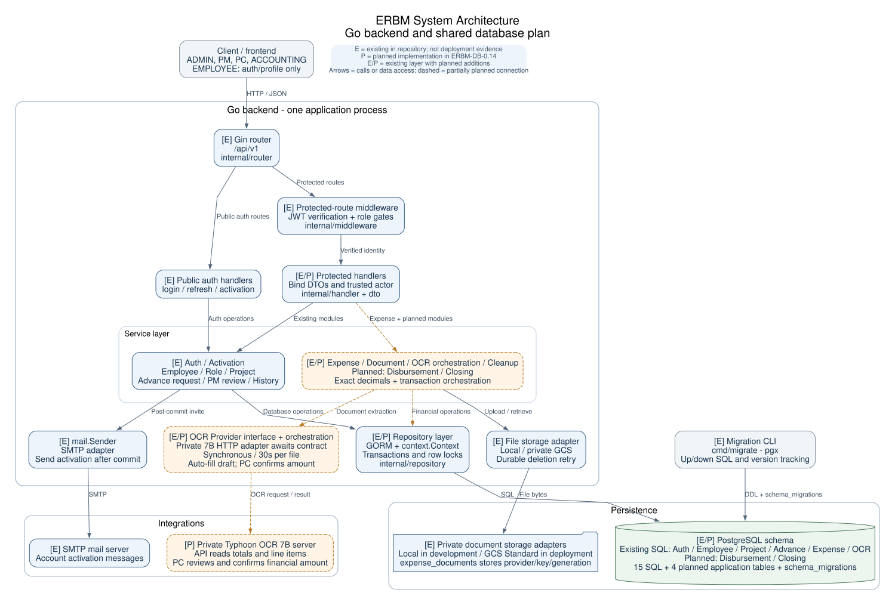
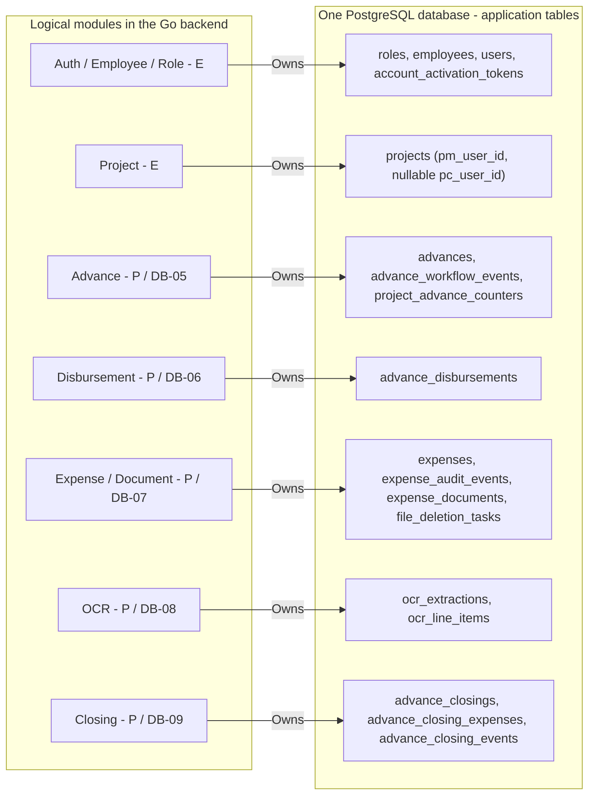
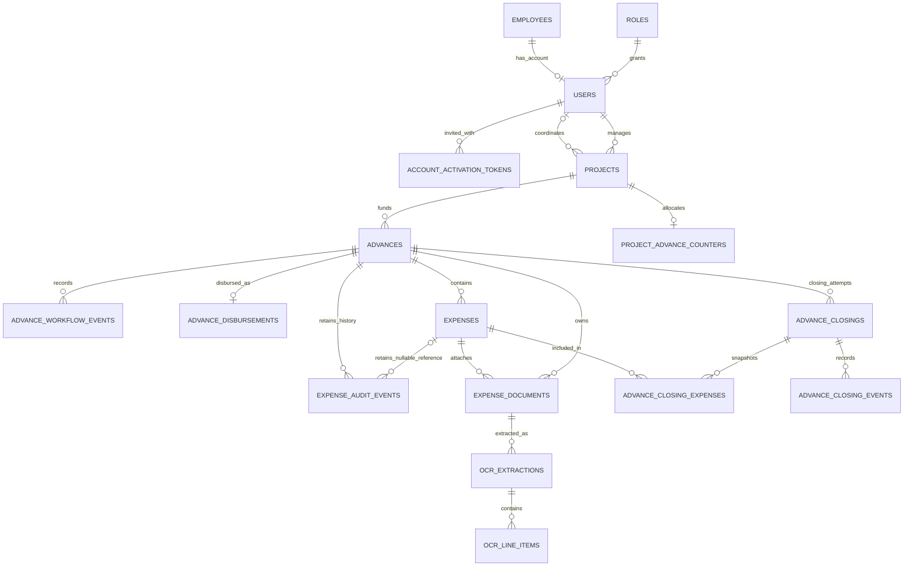

# ERBM — แผนฐานข้อมูลกลางและการแบ่ง migration

รหัสแผน: `ERBM-DB-0.17` · วันที่: 17 พฤศจิกายน 2026

เอกสารนี้เป็น schema blueprint ชุดเดียวสำหรับแจกงานสร้าง migration และ backend
ครอบคลุม **19 application tables: มี SQL แล้ว 16 + เสนอเพิ่ม 3** และ
`schema_migrations` อีก 1 system table ทุกงานควรอ้างรหัสแผนนี้และชื่อ table/column
ในเอกสารเดียวกัน ไม่ออกแบบชื่อหรือความสัมพันธ์ใหม่แยกกันในแต่ละ ticket

สถานะ: **มี SQL 0006/0007/0008 และ Disbursement/Expense API แล้ว; OCR adapter จริงรอ private API contract**
ผู้ใช้เคยแจ้งว่า local apply เฉพาะ 0001, 0002, 0004; จึงใช้ nullable `projects.pc_user_id` โดยตรงใน 0003
และรวม Advance, รหัสถาวร, counter, audit และ ACTIVE guard ใน 0005 โดยตรง
ข้อมูลนี้มาจากผู้ใช้ ไม่ใช่การตรวจฐานจริงหรือสถานะ deployment ล่าสุด; เพิ่มเฉพาะ migration ใหม่ ไม่แก้ version เดิมและไม่รัน migration กับฐาน application

รายละเอียดการทำงาน/API/ลำดับงานใหม่อยู่ใน
[Expense, Receipt และ OCR implementation plan](expense-receipt-ocr-implementation-plan.md)
กติกาที่ระบุ C มาจากคำยืนยันในแชตวันที่ 14 พฤศจิกายน 2026 ส่วน schema/API/cleanup ที่ระบุ P
เป็นข้อเสนอเดิมที่ผู้ใช้อนุญาตให้ implement ในขอบเขต Expense/OCR; Closing ยังรอตัดสินใจ
วันที่ 17 พฤศจิกายน 2026 ผู้ใช้ยืนยัน Accounting จ่ายเต็มยอดที่อนุมัติครั้งเดียว
ผ่าน `POST /api/v1/advances/{id}/disburse` ไม่ส่ง body แล้วเปลี่ยน `APPROVED -> ACTIVE`
ยอดมาจาก Advance ที่ล็อกอยู่ เวลาและ actor มาจาก server/authentication
ดู [Disbursement API](../api/advance-disbursement.md); เพิ่ม 0006 ตามเลขที่จองไว้ ไม่แก้ migration เดิม

คำยืนยันล่าสุด 17 พฤศจิกายน 2026: คืนขนาดใบเสร็จเป็น 10 MB ต่อไฟล์ และรวม
50 MB ต่อ Expense ไม่เกิน 5 ไฟล์ ผู้ใช้ยืนยันว่า migration เพิ่ม 100 MB รันแล้ว
จึงเก็บประวัติเดิมและเพิ่ม `20261117000001_restore_receipt_size_limit` เพื่อคืน CHECK เป็น 10 MB
โดยไม่ลบข้อมูลและไม่แก้ migration ที่ใช้งานแล้ว

## 1. ขอบเขตและแหล่งข้อมูล

ครอบคลุม Auth, Employee, Project, Advance Request, PM review, disbursement,
Expense, เอกสารค่าใช้จ่าย, OCR และ Closing ตาม requirement ปัจจุบัน
ผู้ใช้ยืนยันว่าทุกยอดเงินเป็นเงินบาท (THB) จึงไม่เก็บ currency_code ใน advances
และไม่ต้องมี field นี้ใน request/response ของ Advance ที่จะออกแบบต่อ
ผู้ใช้ยืนยันว่าปิด Project ได้เมื่อไม่มี Advance หรือทุกใบเป็น `CLOSED` แล้ว
สถานะอื่นทุกสถานะรวมถึง `DRAFT` บล็อกการปิด โดยตรวจใน service transaction
ที่ล็อก Project ร่วมกับการสร้าง Advance ไม่ต้องเพิ่ม migration สำหรับกฎนี้
การเบิกคืนโดยไม่มี Advance, supplier/bill payment แยกจาก Expense, tax engine,
fiscal-year policy และ MD digital signature ยังไม่มี requirement เพียงพอ
จึงเป็นรายการขยายขอบเขตที่ต้องตกลงก่อนเพิ่ม schema

คำยืนยันเพิ่มเติม 14 พฤศจิกายน 2026: OCR ของเซิร์ฟเวอร์ส่วนตัว Typhoon OCR 7B
อ่านรายการ/ราคา/ยอดรวมและกรอกฟอร์มให้ PC ตรวจหรือแก้ก่อนกดยืนยัน
ใช้ยอดเดียว amount; ก่อนยืนยันเป็น DRAFT และนับเงินจริงเมื่อ CONFIRMED; ยืนยันศูนย์ได้แต่ห้ามติดลบ/เกินวงเงิน
PC เดิมต้องให้ Advance ทุกสถานะเป็น CLOSED ก่อนเปลี่ยน/ลบ PC รวม DRAFT/APPROVED ตามคำตอบล่าสุด
ต้องปิด/คืนเงินเดิมก่อนเปิด Fund ใหม่เพื่อขอเงินเพิ่ม Expense/receipt ลบจริง และ CLOSED ห้ามแก้ไข
Closing และนโยบายสร้าง DRAFT เพิ่มระหว่าง Fund เดิมยังอยู่ไม่เปลี่ยนใน ticket นี้

| ประเภท | แหล่งข้อมูล | การใช้ในแผน |
| --- | --- | --- |
| Requirement ที่ยืนยัน | [AGENTS.md](../../AGENTS.md) | Project/Advance, บทบาท, ACTIVE invariant, Expense/OCR, Closing equation |
| Workflow ที่ยืนยัน | [advance-workflow](../../.agents/skills/advance-workflow/SKILL.md) | สถานะก่อน Closing, audit และเรื่องที่ห้ามเดา |
| Expense/OCR ที่ยืนยัน | คำตอบและการยืนยัน flow ในแชต 14 พ.ย. 2026; [implementation plan](expense-receipt-ocr-implementation-plan.md) | OCR auto-fill ก่อน PC confirm, null/zero, hard delete, quota/timeout/cache, private 7B และการเปลี่ยน PC |
| Schema ที่มีใน repo | [0001](../../migrations/0001_create_auth_tables.up.sql), [0002](../../migrations/0002_add_employee_user_audit_fields.up.sql), [0003](../../migrations/0003_create_projects.up.sql), [0004](../../migrations/0004_create_account_activation_tokens.up.sql) | ตาราง, column, type, FK, index เดิม |
| Advance SQL ที่สร้างแล้ว | [0005 up](../../migrations/0005_create_advance_workflow.up.sql), [0005 down](../../migrations/0005_create_advance_workflow.down.sql) | โครงสร้าง Advance, audit และ ACTIVE guard ตาม blueprint; ยังไม่ apply |
| Model/API ปัจจุบัน | [model](../../internal/model/project.go), [DTO](../../dto/project.go), [service](../../internal/service/project.go), [repository](../../internal/repository/project.go), [router](../../internal/router/router.go) | รูปแบบ ID, decimal string, สมาชิก Project และขอบเขตที่ทำแล้ว |
| Migration execution | [runner](../../cmd/migrate/main.go), [Makefile](../../Makefile) | การตั้งชื่อ, transaction และ apply/down order |

สัญลักษณ์ในเอกสาร:

- **E — Existing:** มีอยู่ใน migration ปัจจุบัน ให้ใช้ต่อ ไม่สร้างซ้ำ
- **C — Confirmed:** requirement ยืนยันแล้ว แต่การเลือกชื่อ/โครงสร้างใหม่ยังเป็นข้อเสนอ
- **P — Proposed:** รายละเอียดทางเทคนิคที่เสนอให้ทุกคนใช้ร่วมกันหลัง review
- **Dxx — Decision:** เรื่องที่ต้องตัดสินใจก่อนเขียน SQL หรือเปิดใช้ capability ที่เกี่ยวข้อง

## 2. รายการ table ครบชุด

| Table | สถานะ | หน้าที่ | Migration |
| --- | --- | --- | --- |
| `roles` | E | บทบาทของบัญชี | 0001 |
| `employees` | E | ข้อมูลพนักงาน | 0001 + 0002 |
| `users` | E | บัญชีและ credentials | 0001 + 0002 |
| `projects` | E | โครงการ, PM หนึ่งคน และ PC ได้ไม่เกินหนึ่งคนผ่าน nullable pc_user_id | 0003 |
| `project_code_counters` | E (SQL) | เลขลำดับรหัส Project แยกตามปี ค.ศ. เวลาไทย เริ่มใหม่ทุกปี | 0003 |
| `account_activation_tokens` | E | token hash สำหรับเปิดใช้งานบัญชี | 0004 |
| `advances` | E (SQL) | Advance Request, รหัสถาวร และสถานะหลัก; มี GET/POST แล้ว | 0005 |
| `advance_workflow_events` | E (SQL) | ประวัติ Advance; POST บันทึก CREATE พร้อม DRAFT ใน transaction | 0005 |
| `project_advance_counters` | E (SQL) | เลขลำดับอิสระของแต่ละ Project สำหรับออกรหัส Advance | 0005 |
| `advance_disbursements` | E (SQL) | การจ่ายเต็มยอดครั้งเดียวที่ Accounting ยืนยัน พร้อม actor/เวลา | 0006 |
| `expenses` | P | ยอดเดียว amount ที่ OCR กรอก/PC แก้ และ DRAFT/CONFIRMED ที่ PC ยืนยัน | 0007 |
| `expense_audit_events` | P | ประวัติแก้ไขและยืนยัน Expense | 0007 |
| `expense_documents` | P | เอกสารและตำแหน่งไฟล์ค่าใช้จ่าย | 0007 |
| `file_deletion_tasks` | P / technical | งานลบไฟล์ที่อยู่ต่อหลัง hard delete และ retry ได้ | 0007 |
| `ocr_extractions` | P | ผล OCR แต่ละรอบของเอกสาร | 0008 |
| `ocr_line_items` | P | รายการที่ OCR อ่านได้ | 0008 |
| `advance_closings` | P | คำขอปิด Advance และยอด snapshot | 0009 |
| `advance_closing_expenses` | P | Expense ที่นำมาคำนวณ Closing แต่ละครั้ง | 0009 |
| `advance_closing_events` | P | ประวัติส่ง/ตรวจ/จบ Closing | 0009 |
| `schema_migrations` | E / system | runner บันทึก migration ที่ apply แล้ว | runner จัดการ |

0005 ใช้ `advances` table เดียวตั้งแต่ Request จน CLOSED เพื่อไม่ต้อง copy
คำขอที่อนุมัติไปอีก table หรือให้ Expense ต้องเลือกระหว่าง request ID กับ advance ID
ประวัติ revision อยู่ใน event table แทนการสร้าง Advance ใหม่ทุกครั้งที่ PM ส่งกลับ
โครงสร้าง Advance, ประวัติและ counter ถูกเลือกให้สร้างตามแผนแล้ว; workflow/API ที่ยังไม่มี
requirement ยืนยันไม่ถือว่าได้รับการอนุมัติเพิ่มจากการสร้าง SQL

## 3. Architecture และความสัมพันธ์หลัก

### 3.1 System architecture



[SVG สำหรับขยาย/นำไปใช้](diagrams/erbm-system-architecture.svg) ·
[PNG สำหรับแนบเอกสาร](diagrams/erbm-system-architecture.png) ·
[Graphviz source สำหรับแก้ภาพ](diagrams/erbm-system-architecture.dot)

Architecture นี้มี Go backend หนึ่ง application process และ PostgreSQL ตาม
โครงสร้างปัจจุบัน ส่วนโมดูลใหม่เป็น logical modules ใน backend เดียวกัน
สัญลักษณ์ **E** หมายถึงมีใน repository, **P** หมายถึงข้อเสนอในแผน และ
**E/P** หมายถึง layer เดิมที่จะเพิ่มโมดูล เส้นประเป็น connection ที่เสนอใหม่

- **Router / middleware:** Gin จัด route ใต้ `/api/v1`; public auth routes
  มีเส้นทางของตัวเอง ส่วน protected routes ผ่าน JWT และ role middleware
- **Handler / DTO:** bind request และรับ actor จาก authentication ส่งต่อไป service
- **Service:** ตรวจสิทธิ์ตาม Project, business rules, workflow, exact money,
  และประสาน transaction; Advance มี Request/PM review/history/Disbursement และ Expense/OCR orchestration แล้ว ส่วน Closing ยังเป็น P
- **Repository:** เป็นทางเข้า SQL ของ application ผ่าน GORM และ context;
  service ส่ง transaction/lock ที่ใช้ร่วมกันในการเปลี่ยนข้อมูลการเงินและ audit
- **PostgreSQL:** รวม 19 application tables ใน data dictionary นี้ และ
  `schema_migrations`; grouped modules ใช้ฐานเดียวกัน
- **SMTP:** มี `mail.Sender` แล้ว ใช้ส่ง activation หลัง database commit
- **File storage / OCR:** ยืนยัน Local/GCS private และ private Typhoon OCR 7B API แบบ synchronous
  file bytes อยู่ใน storage, metadata อยู่ใน expense_documents, retry ลบไฟล์อยู่ใน file_deletion_tasks
  ผล OCR กลับไปให้ service บันทึก supporting data/เติมร่างผ่าน repository; เขียน amount เฉพาะ DRAFT และไม่ยืนยันรายการอัตโนมัติ
- **Migration CLI:** เป็น process แยกที่ใช้ pgx รัน SQL และบันทึก version
  server startup ปัจจุบันไม่ได้ apply migrations อัตโนมัติ

MD paper signature อยู่ภายนอกระบบใน phase 1 และไม่มี MD integration ในภาพนี้
รายละเอียด deployment host/proxy และ private OCR HTTP contract ยังไม่ยืนยัน
OCR ใช้ synchronous; cleanup worker เป็น P ใน backend process เดิมสำหรับ retry ลบไฟล์

### 3.2 Module และ table ownership สำหรับแบ่งงาน

ภาพนี้จับคู่ความรับผิดชอบของแต่ละ module กับ schema ส่วนการเข้าฐานข้อมูลจริง
ยังผ่าน Service -> Repository -> PostgreSQL ตามภาพ 3.1



Ownership หมายถึงผู้ดูแล schema และกฎของข้อมูลนั้น ข้อมูลที่หลาย module ใช้
ต้องใช้ interface/transaction contract เดียวกันตามหัวข้อ 7 เช่น Closing อ่าน
confirmed Expenses และเปลี่ยน Advance เป็น CLOSED โดยบันทึก audit ร่วมกัน
ไม่มี module ใดสร้างตารางซ้ำเพื่อเลี่ยง dependency ของอีก module

### 3.3 Entity relationships



Cardinality ของตารางที่ยังเป็นข้อเสนอเป็น P โดยเฉพาะการจ่าย 0..1 ครั้ง (D04),
OCR หลายรอบ (D06) และ Closing หลายคำขอ (D07)
API ที่เสนอสร้าง Expense ที่ยังไม่มีราคาก่อน upload จึงใช้ document.expense_id NOT NULL
file_deletion_tasks ไม่มี FK ไป Expense/Document เพื่ออยู่ต่อได้หลัง hard delete
Project ต้องมี PM หนึ่งคนและมี PC ได้ไม่เกินหนึ่งคน; PM/PC แต่ละคนดูแลหลาย Project ได้
โดยใช้ FK ใน `projects` โดยตรง ไม่มี join table สำหรับ PC
FK ของ actor ไป `users` แสดงใน data dictionary แทนการวาดเส้นซ้ำทุก table

## 4. Convention ที่ใช้ร่วมกันสำหรับตารางใหม่ — P

| เรื่อง | ข้อเสนอที่ใช้ใน blueprint | Decision |
| --- | --- | --- |
| Entity ID | `BIGSERIAL` PK, FK เป็น `BIGINT`; ไม่เปลี่ยน `roles.id` เดิมที่เป็น `INTEGER` | D01 |
| Money | `NUMERIC(15,2)`; Go ใช้ decimal string/การคำนวณ exact decimal | D02: precision, scale และเงื่อนไขยอด |
| Currency | ทุกยอดเป็น THB ตามคำยืนยันของผู้ใช้; Advance ไม่มี currency column | C |
| Date/time | วันเอกสาร `DATE`; เหตุการณ์ `TIMESTAMPTZ`; service จัดการ timezone ตอนแสดงผล | D01 |
| FK ของข้อมูลการเงิน/actor ใหม่ | users/advances RESTRICT; children ของ Expense/Document ลบตาม lifecycle; audit nullable FK SET NULL + recorded ID; cleanup ไม่มี FK ไป row ที่ถูกลบ | D03 / P structure |
| Mutable entity audit | common columns ด้านล่าง; `updated_at` และ actor ต้องเขียนโดย service | D01 |
| Workflow history | append-only ผ่าน repository; บันทึกใน transaction เดียวกับการเปลี่ยนข้อมูล | C audit / P structure |
| Amount default | ไม่มี default `0` สำหรับยอดที่ต้องกรอกหรือยืนยัน | D02 |
| Status | `VARCHAR`; ตรวจ transition ใน service; ยังไม่ทำ PostgreSQL ENUM | D05/D07 |
| Financial deletion | C: hard delete Expense/receipt ขณะ ACTIVE; CLOSED immutable; P: audit/cleanup recovery ตาม dictionary | D03/D08 |

Common mutable columns ใช้กับ **`advances`, `expenses`, `advance_closings` เท่านั้น**:

| Column | Type | Nullable | Default | ความหมาย |
| --- | --- | --- | --- | --- |
| `id` | BIGSERIAL | ไม่ | generated | PK |
| `created_at` | TIMESTAMPTZ | ไม่ | NOW() | เวลาเริ่มรายการ |
| `created_by` | BIGINT | ไม่ | ไม่มี | FK `users.id`; จาก authentication |
| `updated_at` | TIMESTAMPTZ | ไม่ | NOW() | เวลาแก้ไข; default ไม่ได้ auto-update |
| `updated_by` | BIGINT | ไม่ | ไม่มี | FK `users.id`; ตอนสร้างเป็น actor คนเดียวกับ created_by |

Common event columns ใช้กับ **`advance_workflow_events`, `expense_audit_events`,
`advance_closing_events` เท่านั้น**:

| Column | Type | Nullable | Default | ความหมาย |
| --- | --- | --- | --- | --- |
| `id` | BIGSERIAL | ไม่ | generated | PK |
| `actor_user_id` | BIGINT | ไม่ | ไม่มี | FK `users.id`; actor ของ action |
| `action` | VARCHAR(50) | ไม่ | ไม่มี | code ของ action; รายการ code ต้องตกลงก่อน implement |
| `reason` | TEXT | ได้ | NULL | ใช้เฉพาะ Advance/Closing ตาม action; Expense audit ไม่มี column นี้ |
| `before_data` | JSONB | ได้ | NULL | snapshot ก่อนเปลี่ยน; NULL สำหรับการสร้าง |
| `after_data` | JSONB | ไม่ | ไม่มี | snapshot หลังเปลี่ยน; amount ใน JSON เก็บเป็น decimal string |
| `occurred_at` | TIMESTAMPTZ | ไม่ | NOW() | เวลาทำรายการ |

Common columns เป็นส่วนหนึ่งของ data dictionary ทุก table ที่ระบุว่าใช้
ห้ามใช้ชื่อใหม่เช่น `user_id` แทน `actor_user_id` หรือ `fund_id` แทน `advance_id`
โดยไม่แก้เอกสารกลางและ downstream tasks พร้อมกัน

## 5. Data dictionary — ตารางเดิม E

ส่วนนี้สรุป schema ในไฟล์ 0001–0004 รวม ALTER จาก 0002 แล้ว
0003 แก้ในไฟล์เดิมตามคำยืนยันของผู้ใช้ว่ายังไม่ apply; ไม่แก้ 0001/0002/0004 ที่ apply แล้ว

### `roles`

| Column | Type | Nullable | Default / key |
| --- | --- | --- | --- |
| `id` | SERIAL | ไม่ | PK |
| `code` | VARCHAR(50) | ไม่ | UNIQUE |
| `name` | VARCHAR(255) | ไม่ | ไม่มี |
| `created_at` | TIMESTAMPTZ | ไม่ | NOW() |

Seed เดิม: `EMPLOYEE`, `ADMIN`, `PC`, `PM`, `ACCOUNTING`; phase 1 ไม่เพิ่ม MD role
เพื่อทำ signature ในระบบ

### `employees`

| Column | Type | Nullable | Default / key |
| --- | --- | --- | --- |
| `id` | BIGSERIAL | ไม่ | PK |
| `first_name` | VARCHAR(255) | ไม่ | ไม่มี |
| `last_name` | VARCHAR(255) | ไม่ | ไม่มี |
| `position` | VARCHAR(255) | ไม่ | ไม่มี |
| `email` | VARCHAR(255) | ไม่ | UNIQUE |
| `date_hired` | DATE | ไม่ | ไม่มี |
| `employment_end_date` | DATE | ได้ | NULL |
| `created_at` | TIMESTAMPTZ | ไม่ | NOW() |
| `updated_at` | TIMESTAMPTZ | ไม่ | NOW() |
| `created_by` | BIGINT | ได้ | FK users; SET NULL |
| `updated_by` | BIGINT | ได้ | FK users; SET NULL |

Employment activity ใช้ `employment_end_date IS NULL`; ไม่เพิ่ม `is_active` column

### `users`

| Column | Type | Nullable | Default / key |
| --- | --- | --- | --- |
| `id` | BIGSERIAL | ไม่ | PK |
| `employee_id` | BIGINT | ไม่ | UNIQUE; FK employees; CASCADE |
| `email` | VARCHAR(255) | ไม่ | UNIQUE |
| `password_hash` | VARCHAR(255) | ได้ | NULL |
| `role_id` | INTEGER | ไม่ | FK roles; RESTRICT |
| `status` | VARCHAR(50) | ไม่ | INVITED |
| `first_login` | BOOLEAN | ไม่ | true |
| `failed_login_attempts` | INTEGER | ไม่ | 0 |
| `locked_until` | TIMESTAMPTZ | ได้ | NULL |
| `last_login_at` | TIMESTAMPTZ | ได้ | NULL |
| `created_at` | TIMESTAMPTZ | ไม่ | NOW() |
| `updated_at` | TIMESTAMPTZ | ไม่ | NOW() |
| `created_by` | BIGINT | ได้ | FK users; SET NULL |
| `updated_by` | BIGINT | ได้ | FK users; SET NULL |

Index เดิม: `idx_users_status(status)`; ยังไม่มี session/refresh-token table
ไม่เพิ่ม token revocation schema โดยถือเป็น requirement ปัจจุบัน

### `projects`

| Column | Type | Nullable | Default / key |
| --- | --- | --- | --- |
| `id` | BIGSERIAL | ไม่ | PK |
| `project_code` | VARCHAR(50) | ไม่ | Service สร้าง PRJ-{ปี ค.ศ. เวลาไทย}-{เลขอย่างน้อย 6 หลัก}; UNIQUE index บน UPPER(project_code) |
| `name` | VARCHAR(255) | ไม่ | ไม่มี |
| `description` | TEXT | ได้ | NULL |
| `start_date` | DATE | ได้ | NULL |
| `end_date` | DATE | ได้ | NULL |
| `status` | VARCHAR(20) | ไม่ | ACTIVE; CHECK ACTIVE/CLOSED |
| `pm_user_id` | BIGINT | ไม่ | FK users; RESTRICT |
| `pc_user_id` | BIGINT | ได้ | NULL; FK users; RESTRICT |
| `closed_at` | TIMESTAMPTZ | ได้ | NULL |
| `closed_by` | BIGINT | ได้ | FK users; SET NULL |
| `created_by` | BIGINT | ได้ | FK users; SET NULL |
| `updated_by` | BIGINT | ได้ | FK users; SET NULL |
| `created_at` | TIMESTAMPTZ | ไม่ | NOW() |
| `updated_at` | TIMESTAMPTZ | ไม่ | NOW() |

มี date-range CHECK, `uq_projects_project_code`, `idx_projects_pm_user_id`,
nonunique `idx_projects_pc_user_id` และ `idx_projects_status`
Project ไม่เก็บงบประมาณ และไม่มี constraint จำกัดยอด Advance/Expense ตามงบของ Project

`pm_user_id` ต้องมีค่าและ `pc_user_id` เป็น nullable FK ใน `projects` โดยตรง
ไม่มี `project_coordinators` table และไม่มี unique constraint บน PM/PC FK
จึงมี PM หนึ่งคนและ PC ได้ไม่เกินหนึ่งคนต่อ Project แต่ PM/PC คนเดิมดูแลหลาย Project ได้
ผู้ใช้ยืนยันว่า 0003 ยังไม่ apply จึงแก้ไฟล์เดิมโดยไม่ต้องมี delta migration หรือ backfill
POST/PATCH รับ `pc_user_id` เดี่ยว; PATCH ไม่ส่ง field นี้เพื่อคงค่าเดิม ส่ง null เพื่อลบ
หรือส่ง ID จำนวนเต็มบวกเพื่อแทนที่ เฉพาะ ADMIN/PM ของ Project เปลี่ยนการมอบหมายได้
PC ผู้สร้าง Project ถูกมอบหมายให้ตนเองอัตโนมัติ และ PC ที่ได้รับมอบหมายแก้ได้เฉพาะชื่อ/รายละเอียด
API response ใช้ `pc` object หรือ null เช่นเดียวกับ `pm` แทน array
Go ใช้ `Project.PCUserID *int64` และ `ProjectDetail.PC *ProjectMember`
PM/PC ที่มอบหมายต้องเป็นบัญชี ACTIVE และมีบทบาทตรงตามหน้าที่
เฉพาะ PC ที่ได้รับมอบหมายสร้าง Advance ได้

### `project_code_counters`

| Column | Type | Nullable | Default / key |
| --- | --- | --- | --- |
| `year` | INTEGER | ไม่ | PK; ปี ค.ศ. ตาม Asia/Bangkok |
| `last_number` | BIGINT | ไม่ | CHECK last_number > 0 |

POST Project ไม่รับรหัสจากผู้ใช้; service สร้าง `PRJ-2026-000001` และเริ่มเลขใหม่
ทุกปีด้วย UPSERT บน counter ของปีนั้น การตรวจสมาชิก การจองเลข และ INSERT Project
ใช้ transaction เดียวกันเพื่อกันรหัสซ้ำและ rollback พร้อมกันเมื่อสร้างไม่สำเร็จ
ปีของรหัสอ้างอิง `created_at` ในเวลาไทย รหัสอยู่ใน response และแก้ผ่าน PATCH ไม่ได้
เลขมีอย่างน้อย 6 หลัก ไม่ตัดทิ้งเมื่อเกิน 999999; ไม่เปลี่ยนรหัสที่เก็บไว้เดิม
รวม table นี้ใน 0003 ที่ผู้ใช้ยืนยันว่ายังไม่ apply; ไม่มี FK ไป Project รายตัว

### `account_activation_tokens`

| Column | Type | Nullable | Default / key |
| --- | --- | --- | --- |
| `id` | BIGSERIAL | ไม่ | PK |
| `user_id` | BIGINT | ไม่ | FK users; CASCADE |
| `token_hash` | CHAR(64) | ไม่ | UNIQUE; ไม่เก็บ plaintext token |
| `expires_at` | TIMESTAMPTZ | ไม่ | ไม่มี |
| `used_at` | TIMESTAMPTZ | ได้ | NULL |
| `invalidated_at` | TIMESTAMPTZ | ได้ | NULL |
| `created_at` | TIMESTAMPTZ | ไม่ | NOW() |

Index เดิม: `idx_account_activation_tokens_user_id(user_id)`

### `schema_migrations`

| Column | Type | Nullable | Default / key |
| --- | --- | --- | --- |
| `version` | TEXT | ไม่ | PK; ชื่อไฟล์ทั้ง stem ไม่รวม .up.sql |
| `applied_at` | TIMESTAMPTZ | ไม่ | NOW() |

runner เป็นเจ้าของ table นี้; ไม่เพิ่มลง migration สำหรับ business tables

## 6. Data dictionary — ตารางใหม่ P

Nullable/default/ความสัมพันธ์ของ advances และ advance_workflow_events ในส่วนนี้
มี SQL ตรงตาม blueprint ใน 0005 แล้ว ส่วน table อื่นยังเป็นข้อเสนอร่วมกัน
ข้อที่ผูกกับ Dxx และไม่ได้ encode ใน 0005 ต้องตอบก่อน implementation ของ behavior นั้น

### `advances`

ใช้ common mutable columns ทั้ง 5 column ในหัวข้อ 4 และเพิ่ม:

| Column | Type | Nullable | Default | ความหมาย |
| --- | --- | --- | --- | --- |
| `project_id` | BIGINT | ไม่ | ไม่มี | FK projects.id |
| `purpose` | TEXT | ไม่ | ไม่มี | เหตุผล/วัตถุประสงค์ของ Request |
| `advance_code` | TEXT | ไม่ | ไม่มี | UNIQUE; ADV-{project_code}-{เลขลำดับใน Project}; สร้างและเก็บถาวรตั้งแต่ DRAFT ใน 0005 |
| `amount` | NUMERIC(15,2) | ไม่ | ไม่มี | จำนวน Advance ที่ใช้ใน Closing equation; การแก้หลังอนุมัติรอ D04 |
| `status` | VARCHAR(40) | ไม่ | DRAFT | สถานะหลัก; Closing placement รอ D05 |
| `submitted_at` | TIMESTAMPTZ | ได้ | NULL | เวลาส่งล่าสุด; ประวัติทุกครั้งอยู่ใน event |
| `submitted_by` | BIGINT | ได้ | NULL | FK users.id; PC ผู้ส่ง |
| `approved_at` | TIMESTAMPTZ | ได้ | NULL | เวลาอนุมัติล่าสุด |
| `approved_by` | BIGINT | ได้ | NULL | FK users.id; PM ผู้อนุมัติ |
| `activated_at` | TIMESTAMPTZ | ได้ | NULL | เวลา Accounting ยืนยันให้ ACTIVE |
| `closed_at` | TIMESTAMPTZ | ได้ | NULL | เวลาปิดสำเร็จ |
| `closed_by` | BIGINT | ได้ | NULL | FK users.id; Accounting ผู้ finalize |

- C: FK ไป Project และ unique protection `uq_advances_one_active_per_project`
  บน `(project_id)` เฉพาะ `status = 'ACTIVE'` อยู่ใน **0005 เดียวกับตาราง**
- P: `idx_advances_project_created(project_id, created_at, id)` สำหรับรายการใน Project
- ไม่มี cached `balance`/`total_expenses` ที่กลายเป็นยอดจริงอีกแหล่งหนึ่ง
- `DRAFT`, `PENDING_PM_APPROVAL`, `RETURNED_FOR_REVISION`, `APPROVED`, `ACTIVE`,
  `CLOSED` เป็นสถานะที่ยืนยัน แต่ยังไม่ทำ CHECK แบบปิดชุดจน D05 ยืนยัน
- ไม่เพิ่ม uniqueness ของ DRAFT/APPROVED หรือเงื่อนไข fiscal year จากการเดา

### `project_advance_counters`

ตาราง technical counter ใน 0005 ไม่มี common mutable/audit columns;
การจองเลขสำเร็จพร้อม CREATE event ของ Advance ใน transaction เดียวกัน

| Column | Type | Nullable | Default / constraint | ความหมาย |
| --- | --- | --- | --- | --- |
| `project_id` | BIGINT | ไม่ | PK, FK projects.id ON DELETE RESTRICT | หนึ่ง counter ต่อ Project |
| `last_number` | BIGINT | ไม่ | CHECK > 0 | เลขล่าสุด; เริ่มที่ 1 ในการ allocate ครั้งแรก และเพิ่มด้วย atomic UPSERT |

รหัสที่ออกแล้วอยู่ใน advances.advance_code ไม่คำนวณใหม่จากชื่อ Project ตอน GET
การ rollback 0005 ลบ Advance, events และ counter; ต้องสำรองหากต้องรักษาข้อมูล

### `advance_workflow_events`

ผู้ใช้ยืนยันประวัติแบบ 2: เก็บทั้งผู้กระทำ เหตุการณ์ เวลา สถานะ เหตุผล
และ snapshot ของคำขอแต่ละรอบ เพื่อย้อนดูยอดและรายละเอียดเดิมหลังมีการแก้ไข
ข้อมูลใน `advances` เป็นค่าปัจจุบัน ส่วน snapshot ที่บันทึกแล้วต้องคงข้อมูลของรอบนั้น
ปัจจุบัน POST บันทึก CREATE, PATCH บันทึก UPDATE และ Submit บันทึก SUBMIT snapshot
แล้ว ผู้ใช้ยืนยัน 19 ต.ค. 2026 ให้ GET revisions คืนเฉพาะรอบที่กด Submit พร้อม
เลข revision เริ่ม 1 แยกต่อ Advance และ snapshot ของแต่ละรอบ; CREATE/UPDATE
ไม่นับเป็นรอบที่ส่ง ดู [Submit และประวัติแต่ละรอบ](../api/advance-submit-revisions.md)
ใช้ event และ submission columns เดิมใน 0005 โดยไม่เพิ่มหรือรัน migration

ใช้ common event columns ทั้ง 7 column ในหัวข้อ 4 และเพิ่ม:

| Column | Type | Nullable | Default | ความหมาย |
| --- | --- | --- | --- | --- |
| `advance_id` | BIGINT | ไม่ | ไม่มี | FK advances.id |
| `previous_status` | VARCHAR(40) | ได้ | NULL | ก่อน action; NULL ตอนสร้าง |
| `resulting_status` | VARCHAR(40) | ไม่ | ไม่มี | หลัง action; เหมือนเดิมได้ถ้าแก้ข้อมูล |

P index: `idx_advance_events_history(advance_id, occurred_at, id)`
เก็บ revision, submit, PM decision, activation และ CLOSED transition
ไม่มี FK ไป Closing/Disbursement เพื่อไม่สร้าง migration cycle; ID ที่เกี่ยวข้อง
อาจอยู่ใน audit snapshot ขณะที่ความสัมพันธ์จริงอยู่ในตารางโดเมน

### `advance_disbursements`

| Column | Type | Nullable | Default | ความหมาย |
| --- | --- | --- | --- | --- |
| `id` | BIGSERIAL | ไม่ | generated | PK |
| `advance_id` | BIGINT | ไม่ | ไม่มี | FK advances.id ON DELETE RESTRICT; UNIQUE หนึ่ง payment ต่อ Advance |
| `amount` | NUMERIC(15,2) | ไม่ | ไม่มี | จำนวนเงินจริงที่ Accounting ยืนยัน |
| `disbursed_at` | TIMESTAMPTZ | ไม่ | ไม่มี | เวลา server ที่ Accounting กดยืนยันว่าจ่ายเต็มยอดแล้ว |
| `confirmed_by` | BIGINT | ไม่ | ไม่มี | FK users.id; Accounting จาก authentication |
| `confirmed_at` | TIMESTAMPTZ | ไม่ | NOW() | เวลาบันทึกการยืนยัน |

สร้าง row เมื่อ Accounting ยืนยันจ่ายเต็มยอดครั้งเดียวตามคำยืนยัน D04 วันที่ 17 พฤศจิกายน 2026
`amount > 0` และคัดลอกยอด `advances.amount` แบบ exact decimal จากแถวที่ล็อกอยู่
ไม่รับยอด/เวลา/actor จาก client และไม่เพิ่ม pending payment statuses หรือ reference/note fields
transaction บันทึก disbursement + เปลี่ยน Advance + audit ด้วยกัน โดยล็อก Project ก่อน Advance
เวลา disbursed_at/confirmed_at/activated_at/event ใช้ server timestamp เดียวกัน

### `expenses`

ใช้ common mutable columns ทั้ง 5 column ในหัวข้อ 4 และเพิ่ม:

| Column | Type | Nullable | Default | ความหมาย |
| --- | --- | --- | --- | --- |
| `advance_id` | BIGINT | ไม่ | ไม่มี | FK advances.id |
| `expense_date` | DATE | ได้ | NULL | วันที่ร่าง; สร้างก่อน OCR ได้ |
| `description` | TEXT | ได้ | NULL | รายละเอียดร่างที่ OCR เติม/PC แก้ |
| `merchant_name` | VARCHAR(255) | ได้ | NULL | ชื่อผู้ขายในร่าง |
| `invoice_no` | VARCHAR(100) | ได้ | NULL | เลขเอกสาร; ไม่กำหนด unique จากการเดา |
| `amount` | NUMERIC(15,2) | ได้ | NULL | ยอดเดียวที่ OCR เติม/PC แก้; นับเงินจริงเมื่อ CONFIRMED เท่านั้น |
| `status` | VARCHAR(20) | ไม่ | DRAFT | DRAFT / CONFIRMED; เปลี่ยนผ่าน confirm/reopen เท่านั้น |
| `line_items` | JSONB | ไม่ | [] | รายการร่างที่แก้ได้; DTO schema และ decimal strings ไม่ใช่ raw OCR |
| `version` | BIGINT | ไม่ | 1 | revision ของร่างสำหรับกัน lost update |
| `confirmed_at` | TIMESTAMPTZ | ได้ | NULL | เวลาที่ PC กดยืนยันจากระบบ |
| `confirmed_by` | BIGINT | ได้ | NULL | FK users.id; PC จาก authentication ไม่ใช่ Accounting approval |

- C: OCR อ่านรายการ/ราคา/ยอดรวมและกรอกร่างอัตโนมัติ; PC ตรวจ/แก้ก่อนกดยืนยัน
- C: ยอด Expense เป็น THB เช่นเดียวกับ Advance; ไม่ทำ currency conversion อัตโนมัติ
- P: `UNIQUE(id, advance_id)` เพื่อให้ downstream composite FK บังคับความสัมพันธ์
  ของ Expense/เอกสาร/Closing กับ Advance เดียวกัน
- P: `idx_expenses_advance_date(advance_id, expense_date, id)`
- CHECK ให้ amount >= 0 เมื่อมีค่า, version > 0; DRAFT ต้องไม่มี confirmed_by/at
  ส่วน CONFIRMED ต้องมี amount และ confirmed_by/at
- P: line_items ต้องเป็น JSON array; validate field/จำนวน/decimal ใน DTO/service
- ใช้ DRAFT/CONFIRMED ตาม flow ที่ผู้ใช้เลือก ไม่เพิ่ม VAT/WHT/category/vendor master
- C ล่าสุด: amount field เดียว; status=CONFIRMED เท่านั้นนับเงินจริง; null คือยังไม่มีราคา ส่วน 0 เป็นราคาที่ Confirm ได้
- C ล่าสุด: หลัง Confirm ต้องกด reopen ก่อนแก้; เปลี่ยนเป็น DRAFT/ล้าง confirmation/เพิ่ม version และหยุดนับยอดทันทีจน Confirm ใหม่
- OCR/PATCH เขียน amount เฉพาะ DRAFT และ OCR ไม่เปลี่ยนสถานะยืนยันอัตโนมัติ
- C: ยอดยืนยันรวมต้องไม่เกิน advances.amount; confirm/update/delete และ audit ใช้ lock/transaction ร่วม
- C: hard delete เมื่อ ACTIVE; CLOSED ห้ามแก้ ลบ แนบ ยืนยัน หรือเริ่ม OCR ใหม่
- ผู้ใช้ยืนยันให้เหลือ amount เดียว แทน draft_amount + confirmed_amount ใน implementation ก่อนหน้า
  มี Expense SQL ใน 0007 และผู้ใช้ยืนยันว่า 0007/0008 ยังไม่เคย apply จึงปรับ 0007 เดิมตาม amount/status โดยไม่สร้าง version เพิ่ม

### `expense_audit_events`

ใช้ common event columns 6 column ในหัวข้อ 4 โดยยกเว้น reason ที่ไม่ได้ใช้งาน และเพิ่ม:

| Column | Type | Nullable | Default | ความหมาย |
| --- | --- | --- | --- | --- |
| `advance_id` | BIGINT | ไม่ | ไม่มี | FK advances.id RESTRICT; ประวัติยังอยู่เมื่อ Expense ถูกลบ |
| `expense_id` | BIGINT | ได้ | NULL | FK expenses.id ON DELETE SET NULL |
| `recorded_expense_id` | BIGINT | ไม่ | ไม่มี | ID ของ Expense ตอนเกิด event; ไม่ใช่ FK ไป row ที่อาจถูกลบ |

P indexes: history `(advance_id, recorded_expense_id, occurred_at, id)` และ nullable expense FK lookup
before/after snapshot ต้องเห็นร่าง/ยอดยืนยัน/version เดิมและใหม่ตาม action
DELETE event อยู่ใน transaction เดียวกับ hard delete โดยไม่คัดลอกไฟล์หรือ raw OCR ลง audit
ไม่สร้าง `previous_status`/`resulting_status` ถ้ายังไม่มี Expense workflow status ที่ยืนยัน

### `expense_documents`

| Column | Type | Nullable | Default | ความหมาย |
| --- | --- | --- | --- | --- |
| `id` | BIGSERIAL | ไม่ | generated | PK |
| `advance_id` | BIGINT | ไม่ | ไม่มี | FK advances.id; เจ้าของเอกสาร |
| `expense_id` | BIGINT | ไม่ | ไม่มี | Expense ที่ยังไม่ยืนยันก็แนบได้; API สร้าง ID ก่อน upload |
| `storage_provider` | VARCHAR(20) | ไม่ | ไม่มี | local หรือ gcs; ไม่ตีความ key ด้วย provider ผิดตัว |
| `storage_key` | TEXT | ไม่ | ไม่มี | key/path อ้างไฟล์; ไม่เก็บ signed URL ที่หมดอายุ |
| `storage_generation` | TEXT | ได้ | NULL | GCS object generation สำหรับลบให้ถูก object รุ่น |
| `original_filename` | TEXT | ไม่ | ไม่มี | ชื่อไฟล์ต้นทาง |
| `content_type` | VARCHAR(100) | ไม่ | ไม่มี | MIME type ที่ตรวจแล้ว |
| `size_bytes` | BIGINT | ไม่ | ไม่มี | ขนาดไฟล์ |
| `page_count` | SMALLINT | ไม่ | ไม่มี | รูปภาพ 1; PDF 1–5 หน้าที่ตรวจแล้ว |
| `sha256` | CHAR(64) | ไม่ | ไม่มี | checksum ของ bytes จริง; ไม่สมมติห้ามไฟล์ซ้ำ |
| `uploaded_by` | BIGINT | ไม่ | ไม่มี | FK users.id |
| `uploaded_at` | TIMESTAMPTZ | ไม่ | NOW() | เวลา upload |

P: composite FK `(expense_id, advance_id) -> expenses(id, advance_id)` ON DELETE CASCADE;
ต้องผูก Advance เดียวกันและสร้าง cleanup task ก่อนลบ metadata
ไม่เพิ่ม single-column expense FK ซ้ำถ้า composite FK ทำหน้าที่นี้แล้ว
P indexes: `(advance_id, uploaded_at, id)` และ `(expense_id)` สำหรับ lookup
C: JPG/JPEG, PNG, PDF; ต่อไฟล์ <=10 MB, ต่อ Expense <=5 ไฟล์/50 MB;
PDF ไม่เกิน 5 หน้าและไม่เข้ารหัส; ตรวจจริงก่อนบันทึกและตรวจ quota ซ้ำภายใต้ Expense lock
P: MIME/positive size/page count มี row CHECK; จำนวน/ขนาดรวมตรวจใน transaction
P: MB ใช้ 1,000,000 bytes; storage key immutable; file bytes เป็น private
Local เปิดผ่าน backend; deploy ใช้ GCS Standard private region เดียวกับ backend
DB rollback ไม่ลบไฟล์ใน storage เอง; ใช้ file_deletion_tasks สำหรับ retry orphan/deleted files
table นี้เป็นเอกสารค่าใช้จ่าย ไม่ได้บังคับ MD signed-document upload ใน phase 1

### `file_deletion_tasks`

P technical table ใน 0007 สำหรับลบไฟล์หลัง database commit และ retry เมื่อ storage ล้มเหลว
ไม่มี FK ไป Expense/Document จึงอยู่ต่อหลัง hard delete ได้ ไม่ใช่ soft-delete ของ Expense
เพิ่มจาก blueprint 0.10 เพื่อให้การลบจริงไม่ทิ้งไฟล์ orphan เมื่อ DB/storage ไม่สำเร็จพร้อมกัน

| Column | Type | Nullable | Default | ความหมาย |
| --- | --- | --- | --- | --- |
| `id` | BIGSERIAL | ไม่ | generated | PK |
| `storage_provider` | VARCHAR(20) | ไม่ | ไม่มี | local/gcs |
| `storage_key` | TEXT | ไม่ | ไม่มี | ไฟล์ที่จะลบ |
| `storage_generation` | TEXT | ได้ | NULL | generation ที่ต้องลบ ถ้าเป็น GCS |
| `status` | VARCHAR(30) | ไม่ | PENDING | technical PENDING/PROCESSING/SUCCEEDED |
| `attempt_count` | INTEGER | ไม่ | 0 | จำนวนครั้งที่ลอง |
| `next_attempt_at` | TIMESTAMPTZ | ไม่ | NOW() | เวลา retry/lease expiry ของงานที่ claim แล้ว |
| `last_error_code` | VARCHAR(100) | ได้ | NULL | ข้อผิดพลาดที่ตัดข้อมูลลับแล้ว |
| `created_by` | BIGINT | ไม่ | ไม่มี | FK users.id RESTRICT; actor ต้นทาง |
| `created_at` | TIMESTAMPTZ | ไม่ | NOW() | เวลาสร้าง task |
| `completed_at` | TIMESTAMPTZ | ได้ | NULL | เวลาลบเสร็จ |

P index `(status, next_attempt_at, id)`; claim งานด้วย short lock/lease ไม่ถือ transaction ขณะเรียก storage
ลบ key ที่ไม่มีแล้วถือว่าสำเร็จเพื่อ retry ได้; ไม่เก็บ bytes/raw OCR/ยอดการเงินใน task
DELETE เสนอคืน 204 เมื่อลบไฟล์ครบ ถ้าทำ DB hard delete แล้วแต่ cleanup ค้างคืน 202
cleanup worker อยู่ใน backend process เดิมและรับงานต่อหลัง restart; ไม่มี restore API

### `ocr_extractions`

| Column | Type | Nullable | Default | ความหมาย |
| --- | --- | --- | --- | --- |
| `id` | BIGSERIAL | ไม่ | generated | PK; หนึ่ง OCR attempt |
| `document_id` | BIGINT | ไม่ | ไม่มี | FK expense_documents.id ON DELETE CASCADE |
| `provider` | VARCHAR(50) | ไม่ | ไม่มี | private Typhoon OCR API; base URL/auth มาจาก configuration |
| `model_version` | VARCHAR(100) | ได้ | NULL | เวอร์ชัน model/parser |
| `status` | VARCHAR(30) | ไม่ | ไม่มี | P: PROCESSING/SUCCEEDED/FAILED; ไม่เพิ่ม business state |
| `input_sha256` | CHAR(64) | ไม่ | ไม่มี | hash ของไฟล์ที่อ่าน |
| `applied_to_draft` | BOOLEAN | ไม่ | false | ผลนี้เคยเติมร่างสำเร็จหรือไม่; ไม่เติม cache ทับ manual correction ซ้ำ |
| `raw_result` | JSONB | ได้ | NULL | response/extraction supporting data |
| `extracted_amount` | NUMERIC(15,2) | ได้ | NULL | ยอดที่ OCR อ่านได้; ไม่ใช้ตัด balance |
| `extracted_currency` | CHAR(3) | ได้ | NULL | สกุลเงินที่ OCR อ่านได้ |
| `error_code` | VARCHAR(100) | ได้ | NULL | error ที่ผ่านการตัดข้อมูลลับแล้ว |
| `requested_by` | BIGINT | ไม่ | ไม่มี | FK users.id; ผู้ขอ OCR; worker ไม่สร้าง actor ปลอม |
| `created_at` | TIMESTAMPTZ | ไม่ | NOW() | เริ่ม attempt |
| `started_at` | TIMESTAMPTZ | ได้ | NULL | เริ่ม processing |
| `finished_at` | TIMESTAMPTZ | ได้ | NULL | จบ attempt |
| `updated_at` | TIMESTAMPTZ | ไม่ | NOW() | service/worker ต้อง update เอง |

P index: `idx_ocr_extractions_document_created(document_id, created_at, id)`
partial unique ต่อ document เฉพาะ PROCESSING เป็น guard เสริม; service ล็อก Expense เดียวกันก่อนตรวจ PROCESSING ของทุก document จึงเริ่มพร้อมกันข้ามไฟล์ไม่ได้
ขณะ PROCESSING บล็อก PATCH/Confirm/reopen/OCR ด้วย 409; ไม่ถือ SQL lock ระหว่างเรียก provider
ผลสำเร็จ/ล้มเหลว/หมดเวลา/cancel ต้องสิ้นสุด attempt; หลัง crash เก็บกวาด attempt ที่เกิน 30 วินาทีก่อนแก้ไขหรือเริ่มใหม่
C: synchronous ทีละไฟล์ deadline รวมทุกหน้า 30 วินาที; private server model 7B
C: คืน cache ผลสำเร็จจนผู้ใช้สั่งอ่านใหม่; failed attempt retry ได้ ไม่เป็น cache; force ใหม่ไม่ลบผลสำเร็จเดิม
C: OCR เติมรายการ ราคา และ amount ใน DRAFT อัตโนมัติ แต่ไม่แก้รายการ CONFIRMED และไม่ยืนยันเอง
P: auto-fill เฉพาะ version ที่ยังตรงกับเริ่ม request; ถ้ามี manual edit ให้คืนผลและ draft_applied=false
private HTTP contract/response/parser ต้องตรวจจาก server จริงก่อนเลือก payload ไม่ใช้ public API alias แทน
ไม่ได้เพิ่ม business states ให้ Advance หรือ Expense จาก OCR status
ไม่เก็บ provider credentials และไม่ใส่ payload ลับลง error/log

### `ocr_line_items`

| Column | Type | Nullable | Default | ความหมาย |
| --- | --- | --- | --- | --- |
| `id` | BIGSERIAL | ไม่ | generated | PK |
| `extraction_id` | BIGINT | ไม่ | ไม่มี | FK ocr_extractions.id ON DELETE CASCADE |
| `line_no` | INTEGER | ไม่ | ไม่มี | ลำดับในผล OCR ของ attempt |
| `page_no` | SMALLINT | ไม่ | ไม่มี | หน้าต้นทาง 1–5 |
| `description` | TEXT | ได้ | NULL | คำที่อ่านได้ |
| `quantity` | NUMERIC(18,6) | ได้ | NULL | ปริมาณ supporting data |
| `unit_price` | NUMERIC(15,2) | ได้ | NULL | ราคาที่อ่านได้ |
| `line_total` | NUMERIC(15,2) | ได้ | NULL | ยอดที่อ่านได้ |

P: `UNIQUE(extraction_id, line_no)` เป็นลำดับของ attempt ไม่ใช่เลขรายการทางบัญชี
ตารางนี้เก็บรายการราคา OCR ต้นฉบับสำหรับ trace กลับ ส่วนรายการที่ PC แก้เป็น expenses.line_items
ห้าม PATCH รายการ OCR ต้นฉบับตามร่างหรือเก็บ manual correction ทับผลต้นฉบับ
ไม่มี code ที่รวม line_total แล้วลด Advance balance

### `advance_closings`

ใช้ common mutable columns ทั้ง 5 column ในหัวข้อ 4 และเพิ่ม:

| Column | Type | Nullable | Default | ความหมาย |
| --- | --- | --- | --- | --- |
| `advance_id` | BIGINT | ไม่ | ไม่มี | FK advances.id |
| `status` | VARCHAR(40) | ไม่ | ไม่มี | ค่าเริ่มต้น/สถานะส่งกลับ/ลำดับตรวจรอ D07 |
| `advance_amount_snapshot` | NUMERIC(15,2) | ไม่ | ไม่มี | จำนวน Advance ตอนคำนวณ Closing |
| `confirmed_expenses_snapshot` | NUMERIC(15,2) | ไม่ | ไม่มี | ยอด Expense ที่ยืนยันตอนคำนวณ |
| `return_amount` | NUMERIC(15,2) | ไม่ | ไม่มี | จำนวนเงินคืนที่ผู้ใช้ระบุ; ไม่มี default 0 อัตโนมัติ |
| `return_reference_no` | VARCHAR(100) | ได้ | NULL | หลักฐานอ้างอิงเงินคืน; requiredness รอ D07 |
| `returned_at` | TIMESTAMPTZ | ได้ | NULL | เวลาคืนจริง ถ้ามีตาม workflow |
| `submitted_at` | TIMESTAMPTZ | ได้ | NULL | เวลาส่งคำขอปิด |
| `submitted_by` | BIGINT | ได้ | NULL | FK users.id; PC |
| `reviewed_at` | TIMESTAMPTZ | ได้ | NULL | เวลาตรวจล่าสุด |
| `reviewed_by` | BIGINT | ได้ | NULL | FK users.id; Accounting |
| `review_note` | TEXT | ได้ | NULL | ข้อสังเกต/เหตุผลล่าสุด; history อยู่ใน event |
| `finalized_at` | TIMESTAMPTZ | ได้ | NULL | เวลาปิดสำเร็จ |
| `finalized_by` | BIGINT | ได้ | NULL | FK users.id; Accounting |

P: `UNIQUE(id, advance_id)` สำหรับ composite FK ของ snapshot items;
index `idx_advance_closings_history(advance_id, created_at, id)`
ไม่ใส่ `UNIQUE(advance_id)` หรือ partial unique ของ closing statuses ที่ยังไม่ยืนยัน
schema รองรับประวัติหลาย attempt; การสร้างกี่คำขอ/การแก้ row เดิมรอ D07
snapshot ไม่ใช่ยอดจริงอีกแหล่งหนึ่ง ก่อน finalize ต้องอ่านยอดจริงใหม่ภายใต้ lock

### `advance_closing_expenses`

| Column | Type | Nullable | Default | ความหมาย |
| --- | --- | --- | --- | --- |
| `closing_id` | BIGINT | ไม่ | ไม่มี | ส่วน PK; composite FK ไป advance_closings |
| `expense_id` | BIGINT | ไม่ | ไม่มี | ส่วน PK; composite FK ไป expenses |
| `advance_id` | BIGINT | ไม่ | ไม่มี | ทำให้ Closing/Expense ต้องเป็น Advance เดียวกัน |
| `confirmed_amount_snapshot` | NUMERIC(15,2) | ไม่ | ไม่มี | จำนวน Expense ตอนคำนวณ Closing |
| `expense_updated_at_snapshot` | TIMESTAMPTZ | ไม่ | ไม่มี | revision marker ของข้อมูลที่ใช้ |

P: PK `(closing_id, expense_id)`;
FK `(closing_id, advance_id) -> advance_closings(id, advance_id)`;
FK `(expense_id, advance_id) -> expenses(id, advance_id)`;
index `(expense_id)` สำหรับค้นประวัติการนำไปปิด
อยู่ 0009 เพราะเป็นส่วนของหลักฐาน Closing ไม่ใช่ table กลางสร้างล่วงหน้า
หาก Expense เปลี่ยนก่อน finalize ต้องคำนวณ/snapshot ใหม่ตาม D07/D08

### `advance_closing_events`

ใช้ common event columns ทั้ง 7 column ในหัวข้อ 4 และเพิ่ม:

| Column | Type | Nullable | Default | ความหมาย |
| --- | --- | --- | --- | --- |
| `closing_id` | BIGINT | ไม่ | ไม่มี | FK advance_closings.id |
| `previous_status` | VARCHAR(40) | ได้ | NULL | ก่อน action |
| `resulting_status` | VARCHAR(40) | ไม่ | ไม่มี | หลัง action; values รอ D07 |

P index: `idx_closing_events_history(closing_id, occurred_at, id)`
ใช้ track workflow ภายใน Closing ส่วน transition หลักไป `advances.status = CLOSED`
บันทึกใน advance_workflow_events ใน transaction เดียวกันด้วย

## 7. แหล่งยอดเงินและ invariant contract

| ข้อมูล | แหล่งที่ทีมใช้ร่วมกัน | การรับรอง |
| --- | --- | --- |
| จำนวน Advance | `advances.amount` | C: ยอดที่อนุมัติและเป็นยอดจ่ายเต็มครั้งเดียวตาม D04 |
| ยอดจ่ายจริง | `advance_disbursements.amount` | C: คัดลอกจาก Advance ที่ล็อกอยู่ตอนยืนยัน ไม่รับ override จาก client |
| จำนวน Expense จริง | `expenses.amount` เฉพาะ status=CONFIRMED | C: DRAFT ยังไม่ยืนยัน; 0 ยืนยันได้; ห้ามติดลบ/เกินวงเงิน |
| ราคาและรายการร่าง | `expenses.amount` ของ DRAFT, `line_items` และรายละเอียดร่าง | C: OCR กรอก/PC แก้; ไม่เข้ายอดจริงก่อน confirm |
| ยอด OCR | `ocr_extractions.extracted_amount`, `ocr_line_items` | C เป็น supporting data เท่านั้น |
| ยอด confirmed รวม | SUM(amount) FILTER (WHERE status=CONFIRMED) ของ Advance ใน transaction | C: ไม่รวม DRAFT; รวมยอด 0 ของ CONFIRMED; ไม่ join receipts/OCR จนยอดซ้ำ |
| ยอดปิดที่เคยตรวจ | snapshots ใน Closing และ snapshot items | P หลักฐาน audit; ต้องเทียบข้อมูลจริงก่อน finalize |

### การทำงานพร้อมกัน

ข้อเสนอใช้ Advance row เป็น lock ร่วมสำหรับการเปลี่ยนสถานะและทุก mutation ของ
Expense/Closing ของ Advance นั้น ผ่าน repository ที่ส่ง context/transaction ร่วมกัน
หาก operation ต้อง lock Project ด้วย ให้กำหนด order `Project -> Advance -> child`
สำหรับทุก path ที่เกี่ยวข้องเพื่อหลีกเลี่ยง deadlock

1. Activation: Accounting ตรวจสถานะและ membership ตาม requirement, บันทึกเงินจริง,
   เปลี่ยนสถานะและเขียน event ใน transaction เดียวกัน; partial unique index ใน 0005
   กันสอง Advance เป็น ACTIVE ใน Project เดียวกันแม้ service request แข่งขันกัน
2. Expense mutation: lock Advance ก่อนอ่านสถานะ ตรวจ ACTIVE และสิทธิ์ PC ของ Project
   แล้วเขียน Expense/confirmation/audit ร่วมกัน ไม่ตรวจสถานะนอก transaction แล้วค่อย insert
   การยืนยันใช้ `total_confirmed + locked_amount <= advances.amount` สำหรับรายการ DRAFT ที่กำลังยืนยัน
   ภายใต้ lock เดียวกัน กันสอง confirmation ใช้เงินคงเหลือก้อนเดียวกัน
3. Closing finalization: lock Advance และคำขอ Closing, อ่าน Expense ที่นับได้จริงใหม่,
   ตรวจ `Advance Amount = Total Confirmed Expenses + Return Amount` ด้วย exact decimal,
   อัปเดต snapshots/ผลตรวจ/สถานะและ events ใน transaction เดียวกัน
4. ไม่ใช้ row CHECK ที่อ้าง SUM ของ Expense อีก table เพื่อแทนการตรวจสมการ
   และไม่อนุมานว่าผู้ใช้มี role แล้วเข้าถึงทุก Project ได้
5. Project closing: lock Project ก่อนตรวจ Advance ของ Project นั้นทุกใบ;
   ถ้ามีสถานะที่ไม่ใช่ `CLOSED` ให้คืน 409 และไม่บันทึก PATCH ส่วนอื่น
   การสร้าง Advance ใช้ lock Project เดียวกันจึงไม่แทรก DRAFT ระหว่างตรวจและ commit
6. หลังเริ่ม Advance Closing จะบันทึก Expense ต่อได้หรือไม่ และสถานะหลักควรเปลี่ยน
   เป็นอะไร ยังต้องตกลง D05/D07; fiscal-year/cancellation และ VAT/WHT ยังรอ D09
7. PC เดิมต้องปิด Fund ก่อนย้าย/ลบ PC; ตรวจการเปลี่ยน assignment จริงภายใต้ Project lock
   รวม Advance ทุกสถานะที่ยังไม่ CLOSED ตามคำตอบล่าสุด รวม DRAFT/APPROVED
8. OCR/storage calls อยู่นอก SQL transaction และ recheck state/version ก่อน finalize
   CLOSED immutable; Closing integration ต้องป้องกัน in-flight OCR เขียนหลังปิด
   เสนอให้เคลียร์ unconfirmed/dirty drafts/attempts ก่อน finalize แต่ยังรอ D07

## 8. แผน migration และขอบเขตงาน

ก่อนหน้านี้ผู้ใช้แจ้งว่า 0003/0005 ยังไม่ apply จึงเคยรวมการแก้ไขไว้ในไฟล์เดิม
revision นี้ไม่ได้ยืนยัน deployed state ใหม่และไม่แก้ migration เดิม
เลข **0006–0008 มีคู่ไฟล์ SQL แล้ว; 0009 ยังเป็นข้อเสนอ**
ใช้ sequential convention ตาม repository/Makefile และคำสั่งผู้ใช้

| Version | Tables / integrity ที่ต้องมาพร้อมกัน | Dependency | Readiness ของ SQL | ผู้รับผิดชอบ / reviewer |
| --- | --- | --- | --- | --- |
| `0003_create_projects` | projects + required PM FK + nullable PC FK + nonunique indexes + project_code_counters รายปี | users เดิม | SQL corrected in place; ผู้ใช้ยืนยันว่ายังไม่ apply | ผู้ทำ Project / integration reviewer |
| `0005_create_advance_workflow` | advances + codes/counters + events + one-ACTIVE partial unique + FKs/indexes | users/projects เดิม | SQL created; ยังไม่ apply/test บน PostgreSQL; workflow ที่ค้างยังไม่ encode | ผู้ทำ Advance / ผู้ทำ Expense |
| `0006_create_advance_disbursements` | advance_disbursements + positive exact amount + FK/unique หนึ่ง payment ต่อ Advance ตาม D04 | 0005 | SQL/API implement แล้ว; ไม่รันกับฐาน application | ผู้ทำ Advance / ผู้ทำ Closing |
| `0007_create_expense_records` | expenses draft/confirmation + expense_audit_events + expense_documents + file_deletion_tasks + composite FK/keys | 0005 | SQL/API implement แล้ว ยังไม่ apply/deploy | ผู้ทำ Expense / ผู้ทำ Advance |
| `0008_create_ocr_evidence` | ocr_extractions + ocr_line_items + FK/index/in-flight guard | 0007 | SQL/orchestration implement แล้ว; private HTTP adapter/parser รอ contract | ผู้ทำ OCR / ผู้ทำ Expense |
| `0009_create_advance_closing` | advance_closings + advance_closing_expenses + advance_closing_events + FKs/keys | 0005, 0007; capability จ่ายจริงต้องมี 0006 | provisional: D02, D03, D05, D07, D08 | ผู้ทำ Closing / ผู้ทำ Advance |
| `20261117000000_increase_receipt_size_limit` | ขยาย expense_documents.size_bytes CHECK เป็น 100,000,000 bytes โดยไม่เพิ่ม table | 0007 | ผู้ใช้ยืนยันว่า apply แล้ว; ถูกคืนเป็น 10 MB ด้วย 20261117000001 | ผู้ทำ Expense / integration reviewer |
| `20261117000001_restore_receipt_size_limit` | คืน expense_documents.size_bytes CHECK เป็น 10,000,000 bytes โดยไม่ลบข้อมูล | 20261117000000 | SQL/API limit คืน 10 MB ต่อไฟล์/50 MB ต่อ Expense; ยังไม่รันกับฐาน application | ผู้ทำ Expense / integration reviewer |

คู่ไฟล์ที่แต่ละ ticket ต้องส่งมอบ:

| Ticket | Up path | Down path |
| --- | --- | --- |
| DB-03 | `migrations/0003_create_projects.up.sql` | `migrations/0003_create_projects.down.sql` |
| DB-05 | `migrations/0005_create_advance_workflow.up.sql` | `migrations/0005_create_advance_workflow.down.sql` |
| DB-06 | `migrations/0006_create_advance_disbursements.up.sql` | `migrations/0006_create_advance_disbursements.down.sql` |
| DB-07 | `migrations/0007_create_expense_records.up.sql` | `migrations/0007_create_expense_records.down.sql` |
| DB-08 | `migrations/0008_create_ocr_evidence.up.sql` | `migrations/0008_create_ocr_evidence.down.sql` |
| DB-09 | `migrations/0009_create_advance_closing.up.sql` | `migrations/0009_create_advance_closing.down.sql` |

### DB-05: Advance workflow

- Up: สร้าง advances พร้อม unique advance_code, project_advance_counters และ event table; ใส่ ACTIVE guard ในไฟล์เดียวกัน
- Boundary: table และประวัติทำให้ Request ใช้ได้ครบ ส่วน guard ต้องไม่อยู่ version ถัดไป
- Interface ส่งต่อ: `advances.id BIGINT`, `advance_code TEXT UNIQUE`, `project_id`, `amount` เป็น THB, `status` และ `project_advance_counters`
- Down: event table ก่อน advances แล้ว counter; ต้องถอน Disbursement/Expense/Closing ก่อนเพราะมี FK
- Acceptance: FK ถูกต้อง, มี ACTIVE สองรายการใน Project เดียวไม่ได้, คนละ Project ได้,
  และ event อยู่ใน transaction ของการเปลี่ยนสถานะ
- Gate: ใช้ Request/review ได้เมื่อ API และ rules พร้อม; เปิด disbursement/activation
  หลัง deploy service และ apply DB-06 แล้วเท่านั้น

### DB-06: Disbursement

- Up: สร้างข้อมูลการจ่ายจริงและ cardinality ตาม D04
- Boundary: Request/approval กับการยืนยันเงินจริงเป็น capability คนละช่วง
- Interface ส่งต่อ: ข้อมูลยอดจริง, เวลา/actor ยืนยัน, ความสัมพันธ์กับ Advance
- Down: drop advance_disbursements; หยุด path ที่อาศัยข้อมูลการจ่ายก่อน rollback
- Acceptance: ไม่มี orphan payment, actor มาจาก Accounting, activation/payment/event
  สำเร็จหรือ rollback พร้อมกัน, duplicate confirmation ทำตาม D04

### DB-07: Expense และเอกสาร

- Up: สร้าง expenses พร้อม amount เดียว/status/version/confirmation metadata และ UNIQUE สำหรับ composite FK,
  nullable audit reference + recorded ID, documents และ file_deletion_tasks
- Boundary: รายการ audit/เอกสาร และ retry ลบไฟล์ต้องเป็น capability เดียวเพื่อทำ hard delete ได้ครบ
- Interface ส่งต่อ: `expenses(id, advance_id)`, `amount`, `status`, `line_items`, `version`,
  `confirmed_by/at`, `expense_documents.id`, provider/key/generation/hash และ cleanup tasks
- Down: จบ/export cleanup tasks ก่อน; drop documents -> expense_audit_events -> file_deletion_tasks -> expenses;
  ต้องถอน 0008/0009 ก่อน และหยุด paths/worker ที่ใช้งาน table เหล่านี้
- Acceptance: เอกสารผูก Expense คนละ Advance ไม่ได้, Expense mutation ตรวจ ACTIVE
  ขณะถือ lock, null ต่างจาก 0, confirm ไม่เกินวงเงิน, hard delete ไม่ทำ audit หาย,
  file deletion retry หลัง restart ได้ และไม่มีไฟล์ orphan ที่ cleanup ไม่ได้

### DB-08: OCR

- Up: extraction ก่อน line items พร้อม input hash และ Expense-wide in-flight guard;
  ไม่แก้ amount ของ CONFIRMED หรือ advances.amount
- Boundary: OCR เป็น supporting pipeline ที่เติมร่างอัตโนมัติ; provider failure ไม่ทำลาย Expense/ยอดยืนยัน
- Interface ส่งต่อ: extraction ของเอกสารและผล line items; ไม่มี authoritative total
- Down: line items -> extractions; เอกสาร/Expense จริงยังอยู่
- Acceptance: OCR retry/history ตาม D06, FK/ลำดับรายการถูกต้อง,
  เติมรายการ/ราคา/ยอดรวมในร่างอัตโนมัติ โดย PC แก้/Confirm/เริ่ม OCR ซ้ำระหว่างรอไม่ได้,
  cache/force/30-second deadline รวมทุกหน้า และไม่เปลี่ยน balance หรือ Closing totals ก่อน confirm

### DB-09: Closing

- Up: closings พร้อม composite unique -> snapshot items -> closing events
- Boundary: คำขอปิด, หลักฐานยอด และประวัติการตรวจเป็นชุดเดียวที่ตรวจสอบย้อนหลังได้
- Interface ส่งต่อ: closing/advance ID, snapshot totals/items, finalization actor/time
- Down: closing events -> snapshot items -> closings; หยุด Closing path ก่อน rollback
- Acceptance: snapshot Expense คนละ Advance ถูกปฏิเสธ, คำนวณยอดจริงก่อน finalize,
  สมการตรงจึงปิดได้, ยอดไม่ตรงไม่ปิด, concurrency กับ Expense mutation ไม่ใช้ยอดเก่า

## 9. Apply, rollback และข้อมูลเดิม

ลำดับโมดูลที่เสนอ: `0005 -> 0006 -> 0007 -> 0008 -> 0009`; ฐาน local ที่ผู้ใช้แจ้งต้อง apply 0003 ก่อน 0005
dependency ของ DB-07 ไม่บังคับรอ DB-06 ตอนออกแบบ และ DB-09 ไม่พึ่งผล OCR
ส่วน runner เรียงชื่อไฟล์จึง apply ตามลำดับชื่อเมื่อไฟล์ทั้งหมดอยู่ใน release เดียวกัน

ย้อนกลับโมดูล: `0009 -> 0008 -> 0007 -> 0006 -> 0005`
ทุก down ที่ drop table ลบข้อมูลใน table ด้วย การ recreate ด้วย up ไม่กู้ข้อมูลนั้น
การถอนบนฐานที่มีข้อมูลจริงต้องประเมิน backup/restore หรือใช้ forward fix และ
deploy application ที่ไม่เรียก schema ที่จะถอดก่อน ไม่ใช้ `CASCADE` ซ่อน dependency

ตารางใหม่ตาม baseline ไม่ต้องย้ายข้อมูล legacy ถ้าฐานจริงตรงกับไฟล์เดิม
ก่อน execute ต้องยืนยัน applied versions/schema จริงและตรวจว่ามีงานอีก branch,
manual schema หรือข้อมูลนำเข้าที่ต้อง backfill หรือไม่ โดยไม่อ่าน `.env`

ถ้าพบ table เดิมที่ต้องเพิ่ม required field หรือ unique rule ให้ปรับเป็น
expand -> backfill/validate -> constrain/contract ตามข้อมูลจริง แยก commit/ช่วง deploy
เมื่อมีเหตุผลเรื่องข้อมูล/locking และระบุ gate ของแต่ละช่วงใน plan revision ถัดไป
ไม่เพิ่ม backfill versions ว่างล่วงหน้า

### ข้อจำกัด runner ที่ต้องใช้ในการแจกงาน

- `up` รัน pending ทุกไฟล์; ไม่มี target version จึงเก็บ version ที่ยังไม่พร้อมไว้นอก
  deployable set ไม่ใช้ชื่อ placeholder หรือ comment-only migration ใน migrations/
- แต่ละ version commit แยกกัน; หาก 0008 ล้มเหลว 0005–0007 ที่สำเร็จยังอยู่
  ตรวจ transaction result แล้วแก้เฉพาะ version ที่ยังไม่ applied เพื่อ resume
- `down` เลือก stem ที่เรียงสูงสุดใน applied set ครั้งละหนึ่ง ไม่เลือกตาม applied_at
- การ discover `*.up.sql` ของ Go รวม `.template.up.sql`; template ที่มีแต่ comment
  ก็ไม่ใช่ empty string ต้องแก้/จัดการ discovery ก่อน execution (D10)
- ทุกไฟล์อยู่ใน transaction จึงใช้ `CREATE INDEX CONCURRENTLY` ไม่ได้
  schema ใหม่เสนอ index ปกติ; หากฐานใหญ่ต้องวางวิธี execution ที่รองรับก่อน
- Makefile อ่าน `.env` เมื่อ invoke จึงไม่ใช้ `make` ในงานวางแผนนี้

## 10. แบ่งงานโดยใช้ schema เดียวกัน

ไม่กำหนดจำนวนคนที่ผู้ใช้ยังไม่ได้ระบุ ใช้ชื่อกลุ่มงานที่จับคู่คนได้
ถ้ามี 3 คน แนะนำรวม Advance+Disbursement, Expense+OCR, Closing+integration
ถ้ามีคนเพิ่มสามารถแยก OCR/review/verification โดยไม่แบ่ง version ใหม่เพื่อให้ครบจำนวนคน

| งาน | เจ้าของงานเชิงบทบาท | เริ่มได้เมื่อ | ทำขนานได้ | Handoff ที่ต้องส่ง |
| --- | --- | --- | --- | --- |
| ยืนยัน common schema/จองเลข | Integration owner | ตอนนี้ | ทุกกลุ่มเตรียม decision sheet | revision ของเอกสารกลาง + resolved Dxx + version registry |
| DB-05/06 | Advance owner | 0005/0006 มี SQL แล้ว; Disbursement ยืนยันเต็มยอดครั้งเดียว | Expense/OCR/Closing ออกแบบ | up/down, model interface, transaction/audit contract, test evidence |
| DB-03 | Project owner | 0003 แก้ใน version เดิมที่ยังไม่ apply | Advance integration | direct nullable PC FK/nonunique index, membership tests |
| DB-07 | Expense owner | ออกแบบได้ตอนนี้; implementation หลัง Advance interface คงที่ | Advance, OCR และ Closing design | composite keys, amount confirmation contract, upload relation |
| DB-08 | OCR owner | raw response/receipt model ตกลง; implementation หลัง document interface คงที่ | Expense/Closing | supporting-data contract, retry/results, ไม่มี balance side effects |
| DB-09 | Closing owner | design ได้ตอนนี้; implementation หลัง amount/confirmation/closing rules คงที่ | OCR | snapshot contract, finalize transaction, financial invariant evidence |
| Integration verification | Integration owner + reviewer | pairs ที่จะ deploy review ผ่าน | เจ้าของงานเตรียม fixtures | full apply/down plan, compatibility, แสดง checks ที่รันจริง |

ทุก ticket ให้แนบข้อความนี้:

> อ้าง `docs/migration-plans/erbm-database-plan.md`, revision `ERBM-DB-0.14`,
> ขอบเขต DB-xx ใช้ชื่อ table/column/type และ dependency ตามเอกสารกลาง
> ตอบ Dxx ที่เกี่ยวข้องก่อนสร้าง SQL ห้ามเปลี่ยน schema interface แยกจากแผน
> ส่งคู่ up/down, rationale ของข้อแตกต่างถ้ามี, และ acceptance evidence

เมื่อมีการเปลี่ยน field/relationship ให้แก้เอกสารกลาง เพิ่ม revision และระบุ ticket
ที่ได้รับผลกระทบก่อน merge downstream งานส่วน design/test ที่ไม่พึ่งคำตอบเริ่มได้เลย
การจองเลขต้องมีผู้ดูแลคนเดียวเพราะ generator มองเฉพาะไฟล์ของ checkout ปัจจุบัน

## 11. Decisions ที่ต้องตกลง — ไม่ใช่ช่องว่างให้แต่ละคนเดา

| ID | สิ่งที่ต้องยืนยัน | ข้อเสนอ/ทางเลือกใน blueprint | กระทบ |
| --- | --- | --- | --- |
| D01 | รับชื่อ/type/common audit และ Request/Advance table เดียวหรือไม่ | ใช้ชื่อและ fields ในเอกสาร; requests อยู่ใน advances ตั้งแต่ DRAFT | 0005, 0007, 0009 |
| D02 | ขนาด/scale ของเงินและเงินศูนย์/ติดลบ | C: Advance >0; Expense amount >=0 เมื่อมีค่า และนับเงินจริงเฉพาะ CONFIRMED; THB; P: NUMERIC(15,2) ใน Expense/OCR, ไม่ปัดเศษเงียบ ๆ; ไม่เปลี่ยน CHECK โมดูลอื่น | 0007/0008/0009 |
| D03 | delete/retention/financial corrections/actor preservation | C: hard delete Expense/receipt เมื่อ ACTIVE, CLOSED immutable; P: child lifecycle cascade, audit SET NULL+recorded ID และ file_deletion_tasks สำหรับ retry ลบไฟล์; ต้อง review schema/recovery | 0007/0008; Closing FK ใน 0009 |
| D04 | จ่ายครั้งเดียว/หลายครั้ง/บางส่วน และยอดจริงต่างจาก request | C 17 พ.ย. 2026: จ่ายเต็มยอดที่อนุมัติครั้งเดียว; POST disburse ไม่ส่ง body, server copy amount และบันทึกเวลา/actor พร้อม APPROVED -> ACTIVE | 0005 semantics, 0006, 0009 totals |
| D05 | Closing placement และคำขอ DRAFT เทียบกับ Fund | เดิมเคยอนุญาต DRAFT ระหว่าง ACTIVE; C ล่าสุด: ปิด/คืน Fund เดิมก่อนเปิด Fund ใหม่เพื่อขอเพิ่ม; คำตอบล่าสุด: Advance ทุกสถานะต้อง CLOSED ก่อนเปลี่ยน/ลบ PC; นโยบายสร้างคำขอ DRAFT เดิมคงไว้; Closing statuses ยังรอ | Advance Create/Project guard, 0009 |
| D06 | ไฟล์/storage/OCR integration | C: JPG/JPEG/PNG/PDF, 10 MB/ไฟล์, 5 ไฟล์/50 MB (ยืนยันคืนค่าเดิม 17 พ.ย. 2026), PDF <=5 หน้าไม่เข้ารหัส; Local และ GCS Standard private region เดียว backend; private Typhoon OCR 7B API synchronous deadline รวม 30s, cache จนสั่งอ่านใหม่, OCR auto-fill ก่อน PC ตรวจ/แก้; P: สร้าง Expense เปล่าก่อน upload, raw+normalized OCR แยกจาก editable draft; ยังต้องได้ private HTTP contract | 0007/0008, 20261117000001_restore_receipt_size_limit และ adapters |
| D07 | Closing statuses, return/revision behavior, จำนวนคำขอ, evidence เงินคืน, Expense ระหว่าง Closing | รองรับหลาย attempt + snapshots; ไม่ตั้ง default/enum/unique status ที่ยังไม่ยืนยัน | 0009; service ที่เกี่ยวข้อง |
| D08 | Expense confirmation และ over-budget | C: PC ตรวจ/แก้ร่างที่ OCR กรอกแล้วกดยืนยัน; ใช้ amount เฉพาะ CONFIRMED, ศูนย์ได้ ห้ามติดลบและห้ามเกินวงเงิน; hard delete เมื่อ ACTIVE; C ล่าสุด: amount เดียว, confirm/reopen endpoint/version; reopen หยุดนับเงินจนยืนยันใหม่; Closing กับ unconfirmed/dirty draft ยังรอ D07 | 0007/0009 และ service |
| D09 | Project closing กับ Advance ค้าง, fiscal-year/cancellation และ VAT/WHT | ผู้ใช้ยืนยัน 17 ต.ค. 2026: สร้าง Advance ไม่ได้เมื่อ Project CLOSED และห้ามปิด Project ถ้ามี Advance ที่ยังไม่ CLOSED ทุกสถานะรวม DRAFT; ตรวจภายใต้ Project lock ใน service ไม่เพิ่ม schema; fiscal-year/cancellation และ VAT/WHT ยังรอตัดสินใจ | Project service; schema expansion เฉพาะเรื่องที่ยังรอตกลง |
| D11 | จำนวน PM/PC ต่อ Project และ representation | C: PM หนึ่ง/PC ไม่เกินหนึ่ง, ดูแลหลาย Project ได้, nullable projects.pc_user_id; scalar POST/PATCH และ pc response; PC เดิมต้องเคลียร์/ปิด Fund ก่อนเปลี่ยน PC ให้คนใหม่เปิด Fund ใหม่; C ล่าสุด: guard รวมการ remove assignment และ Advance ทุกสถานะรวม DRAFT/APPROVED ต้อง CLOSED | Project/Advance/Expense |
| D10 | naming conflict และ template discovery ของ runner | คง sequential convention; จัดการ discovery ก่อน run และจองเลขร่วมกัน | implementation/integration ของทุก version |
| D12 | Project code อัตโนมัติ | ผู้ใช้ยืนยัน 18 ต.ค. 2026: PRJ-2026-000001 ไม่ต้องกรอก; ปี ค.ศ. ตามเวลาไทย เริ่มเลขใหม่ทุกปี; counter ใน 0003 ที่ยังไม่ apply; transaction เดียวกับการสร้าง Project | Project API / 0003 / รหัส Advance |

เมื่อ review รับบาง Dxx ให้บันทึกคำตอบ/แหล่งที่ยืนยันในแถวนี้และปรับ data dictionary
พร้อมกัน version ที่ไม่ติด Dxx อื่นจึงเลื่อนเป็น ready ได้ ไม่ต้องรอคำตอบทั้งระบบ

## 12. Definition of done และการตรวจสอบ

สำหรับ planning artifact นี้: inventory ทุก table ต้องมี data dictionary, FK targets
และ types ต้องตรงกัน, common columns ต้องมีผู้ใช้ชัดเจน, dependency ไม่มี cycle,
แต่ละ version มี owner/reviewer/up/down/acceptance และ unresolved rules ไม่ถูกซ่อน

สำหรับ migration/backend implementation ในอนาคต:

1. ทำ clean apply จากฐานทดสอบว่างตามลำดับ 0001–0009 ที่อนุมัติ และ upgrade จาก
   baseline ที่ยืนยันพร้อม representative existing data
2. ตรวจ FK/uniques/compound relation ด้วย negative cases รวม cross-Advance document
   และ Closing snapshot, activation พร้อมกันสองรายการใน Project เดียวกัน
3. ตรวจ Expense mutation แข่งกับ Closing finalize, manual amount ต่างจาก OCR,
   ยอดตรง/ไม่ตรงสมการและ audit rollback พร้อม business mutation
4. ตรวจ down/up บน disposable fixtures เท่านั้น; ตรวจ restore แยกถ้าจะใช้ rollback
   กับข้อมูลจริง และตรวจว่า old/new application อยู่ร่วมกับ schema ในช่วง deploy ได้
5. เพิ่ม backend tests ใหม่ใน root-level `tests/` ตาม AGENTS.md เมื่อ behavior เปลี่ยน

คำสั่งเมื่อมีการเปลี่ยน Go:

```sh
gofmt -w <changed-go-files>
go test ./...
go vet ./...
go build ./cmd/server ./cmd/migrate
```

0003/0005 มี SQL และ Advance Request/PM review/history แล้ว แต่รอบวางแผนนี้ไม่ได้ตรวจ applied state
หรือรัน PostgreSQL จริง ไฟล์ที่มีใน checkout ได้แก่ `tests/advance_create_postgres_test.go`,
`tests/advance_repository_test.go` และ Project/PostgreSQL tests ครอบคลุม codes, concurrent creation,
audit rollback, ACTIVE unique guard, FK และ down/up ตามขอบเขตในแต่ละไฟล์
ไม่อ้างไฟล์ `tests/advance_workflow_migration_test.go` ที่ไม่พบใน checkout นี้
tests ใช้เฉพาะ `ERBM_MIGRATION_TEST_DATABASE_URL` และ isolated schema;
เมื่อไม่กำหนดจะ skip โดยไม่อ่าน `.env` หรือใช้ DATABASE_URL ของ app
การตรวจฐานจริงและ acceptance execution ของ Expense/OCR/Closing ยังเป็นแผน

บันทึก 16 ตุลาคม 2026: ผู้ใช้ยืนยันรหัส ADV-PRJ001-001 รันแยก Projectตั้งแต่ DRAFT,
requester คือ PC ผู้สร้าง, ยอดต้องกรอกและมากกว่า 0, Project CLOSED สร้างไม่ได้,
ACTIVE เดิมไม่บล็อก DRAFT และหนึ่ง Project มี ACTIVE ได้ไม่เกินหนึ่งรายการ

บันทึก revision 0.6: ผู้ใช้แจ้งว่า apply เฉพาะ 0001/0002/0004 และอนุญาตให้แก้ version ที่ยังไม่ apply โดยตรง จึงรวม single-PC ใน 0003 และ codes/counter ใน 0005 พร้อมเอาคู่ delta ที่ยังไม่ใช้ออก ไม่มีการรัน migration หรือแก้ version ที่ผู้ใช้แจ้งว่าใช้แล้ว

บันทึก revision 0.7: ผู้ใช้ยืนยันว่าแต่ละ Project มี PC ได้คนเดียว แต่ PC คนเดียวดูแลหลาย Project ได้ และตกลงให้ CreateProjectRequest ใช้ pc_user_id เป็น ID เดียว จึงปรับเฉพาะ POST contract พร้อม validation และเอกสาร โดยไม่เปลี่ยน PATCH, response หรือ schema

บันทึก revision 0.8 (แทนข้อกำหนด Project ของ 0.7): ผู้ใช้ยืนยันให้ลบ join table และเก็บ nullable `projects.pc_user_id BIGINT` FK users ON DELETE RESTRICT พร้อม nonunique index ใน 0003 ที่ยังไม่ apply; PM หนึ่งคนต่อ Project และ PM/PC ดูแลหลาย Project ได้ ใช้ scalar `pc_user_id` ใน POST/PATCH และ `pc` object/null ใน response; PATCH รองรับไม่ส่ง/ส่ง null/ส่ง ID เพื่อคง/ลบ/แทนที่ตามสิทธิ์เดิม ปรับ blueprint เป็น 17 application tables (มี SQL 8 + เสนอเพิ่ม 9) โดยไม่รัน migration หรือเข้าถึงฐานข้อมูล

บันทึก revision 0.10: เพิ่ม project_code_counters ใน 0003 และให้ backend ออกรหัส Project อัตโนมัติ PRJ-{ปี ค.ศ. เวลาไทย}-{เลขอย่างน้อย 6 หลัก} เริ่ม 000001 ทุกปี; POST ไม่ต้องส่ง project_code, response คง field เดิม; จองเลขและสร้าง Project ใน transaction เดียวกัน ปรับจำนวนเป็น 18 application tables (มี SQL 9 + เสนอเพิ่ม 9) โดยไม่รัน migration กับฐาน application

บันทึก revision 0.11 (14 พฤศจิกายน 2026): ผู้ใช้ยืนยัน OCR auto-fill รายการ/ราคา/ยอดรวมก่อน PC ตรวจแก้และกดยืนยัน, confirmed_amount ศูนย์ได้แต่ห้ามติดลบ/เกินวงเงิน, hard delete ขณะ ACTIVE และ CLOSED immutable, ปิด Fund เดิมก่อนเปลี่ยน PC/ขอ Fund ใหม่, file quotas และ private Typhoon OCR 7B synchronous 30s/cache/force ตาม implementation plan ปรับ dictionary ร่าง/ยอดยืนยันและ audit hard-delete เสนอเพิ่ม file_deletion_tasks ใน DB-07 ทำให้เป็น 19 application tables (SQL 9 + เสนอ 10) ยังไม่สร้าง/แก้/รัน SQL หรือ API และยังไม่ตรวจฐานจริง

บันทึก revision 0.12 (14 พฤศจิกายน 2026): เริ่ม implementation ตามที่ผู้ใช้อนุญาต เพิ่ม SQL 0007/0008 (6 tables) และ Expense/receipt/confirm/reconciliation API, local/GCS storage, durable cleanup, OCR orchestration และ tests จึงเป็น SQL 15 + เสนอ 4 รวม 19 application tables; PC reassignment/removal บล็อก Advance ทุกสถานะที่ไม่ CLOSED ตามคำตอบล่าสุด ส่วน private OCR adapter/parser รอ custom contract ไม่เปลี่ยน Advance Create/Closing และไม่รัน migration กับฐาน application ดู [Expense API](../expense-api.md)

บันทึก revision 0.13 (14 พฤศจิกายน 2026): ผู้ใช้เลือก amount field เดียว + DRAFT/CONFIRMED และให้กดกลับมาแก้ไขหลัง Confirm ได้ โดยยกเลิกการยืนยันและหยุดนับยอดจนยืนยันใหม่ เพิ่ม POST /expenses/{id}/reopen, ปรับ 0007 เดิมที่ผู้ใช้ยืนยันว่า 0007/0008 ยังไม่เคย apply, DTO/repository/OCR/total/tests/docs ให้ตรงกัน ไม่สร้าง migration version เพิ่มและไม่รันกับฐาน application

บันทึก revision 0.14 (15 พฤศจิกายน 2026): ผู้ใช้ยืนยันล็อกระดับ Expense ระหว่าง OCR ไม่ให้แก้ราคา/Confirm/อ่านซ้ำข้ามใบเสร็จ และปลดล็อกเมื่อสำเร็จ/ล้มเหลว/timeout พร้อม retry ได้ ตัด draft_version_at_request, ExpenseAuditEvent.reason, OCRLineItem.raw_data และ DirtyCount ที่ซ้ำ UnconfirmedCount โดยเก็บ Expense.Version ป้องกันหน้าจอเก่าทับผลใหม่ ปรับ migration 0007/0008 เดิมตามคำยืนยันว่าไม่เคย apply; ไม่รัน SQL กับฐาน application

บันทึก revision 0.15 (17 พฤศจิกายน 2026): ผู้ใช้ยืนยันให้ Accounting จ่ายเต็มยอดที่ PM อนุมัติครั้งเดียวผ่าน POST /advances/{id}/disburse แบบไม่ส่ง body แล้ว APPROVED -> ACTIVE เพิ่ม migration 0006 ตามเลขที่จองไว้, payment model/repository/service/handler และ DISBURSE audit พร้อม Project -> Advance locks และ DB unique guards โดยไม่แก้ migration เดิม จำนวน application tables เป็น SQL 16 + เสนอ 3 รวม 19; tests รวม PostgreSQL concurrency/rollback/up-down ผ่านในฐานทดสอบชั่วคราว ไม่รัน migration กับฐาน application ดู [Disbursement API และผลตรวจ](../api/advance-disbursement.md)

บันทึก revision 0.16 (17 พฤศจิกายน 2026): ผู้ใช้ยืนยันขยายใบเสร็จเป็น 100 MB ต่อไฟล์/500 MB ต่อ Expense ไม่เกิน 5 ไฟล์ ปรับ HTTP/storage/OCR/service และเพิ่มคู่ migration 20261117000000_increase_receipt_size_limit เพื่อขยาย size CHECK โดยไม่แก้ 0007 เดิม; จำนวน tables คงเดิม ยังไม่รัน migration กับฐาน application และ PostgreSQL up/down tests ใหม่ยังไม่ได้รันเพราะไม่ได้รับอนุญาตให้สร้างฐาน disposable ดู [ผลตรวจ](../expense-implementation-checks.md)

บันทึก revision 0.17 (17 พฤศจิกายน 2026): ผู้ใช้ขอคืนขนาดเดิม 10 MB ต่อไฟล์/50 MB ต่อ Expense ไม่เกิน 5 ไฟล์ และ PDF ไม่เกิน 5 หน้า ยืนยันว่า migration 20261117000000 รันแล้ว จึงเก็บไฟล์เดิมและเพิ่มคู่ 20261117000001_restore_receipt_size_limit เพื่อคืน CHECK โดยไม่ลบข้อมูล ไม่รันกับฐาน application ปรับ validation/quota/Swagger/Postman/tests ให้ตรงค่าเดิม
