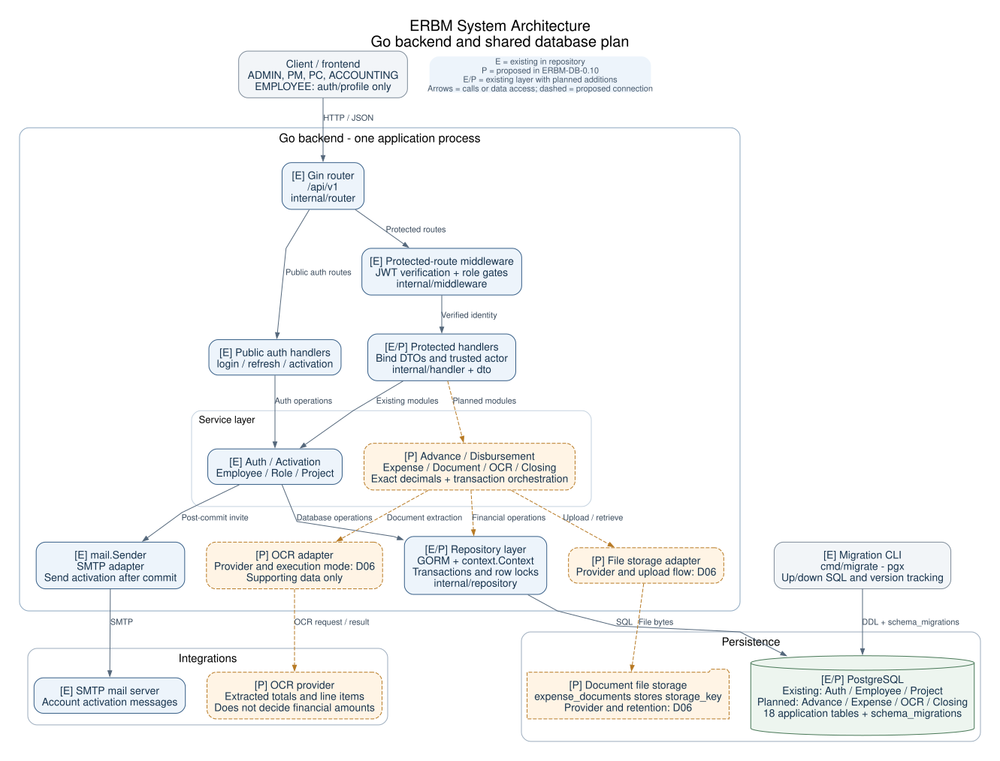
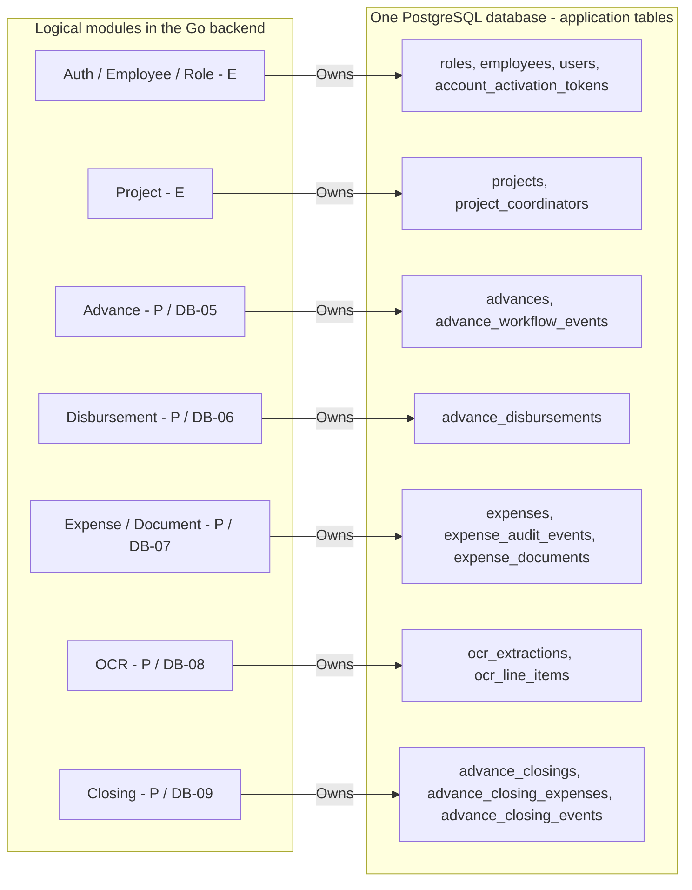
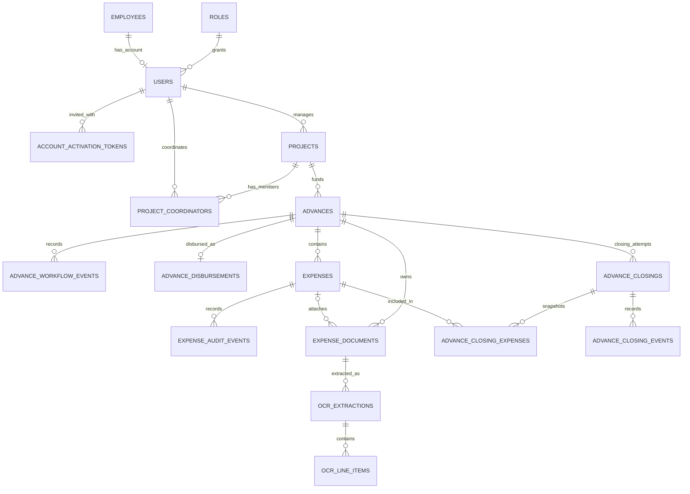

# ERBM — แผนฐานข้อมูลกลางและการแบ่ง migration

รหัสแผน: `ERBM-DB-0.2` · วันที่: 15 ตุลาคม 2026

เอกสารนี้เป็น schema blueprint ชุดเดียวสำหรับแจกงานสร้าง migration และ backend
ครอบคลุม **17 application tables: มี SQL แล้ว 8 + เสนอเพิ่ม 9** และ
`schema_migrations` อีก 1 system table ทุกงานควรอ้างรหัสแผนนี้และชื่อ table/column
ในเอกสารเดียวกัน ไม่ออกแบบชื่อหรือความสัมพันธ์ใหม่แยกกันในแต่ละ ticket

สถานะ: **แผนกลางพร้อม SQL สำหรับ Advance ใน 0005** ผู้ใช้เลือกให้สร้าง Advance
ตาม blueprint นี้ จึงมีคู่ไฟล์ 0005 สำหรับ advances และ advance_workflow_events แล้ว
ยังไม่ได้ apply ฐานจริง ส่วนโมดูลอื่นและ business rules ที่ค้างอยู่ยังเป็นข้อเสนอ
ข้อมูล schema ในเอกสารอ้างจาก repository ไม่ใช่การตรวจฐานข้อมูลที่ deploy แล้ว

## 1. ขอบเขตและแหล่งข้อมูล

ครอบคลุม Auth, Employee, Project, Advance Request, PM review, disbursement,
Expense, เอกสารค่าใช้จ่าย, OCR และ Closing ตาม requirement ปัจจุบัน
การเบิกคืนโดยไม่มี Advance, supplier/bill payment แยกจาก Expense, tax engine,
fiscal-year policy และ MD digital signature ยังไม่มี requirement เพียงพอ
จึงเป็นรายการขยายขอบเขตที่ต้องตกลงก่อนเพิ่ม schema

| ประเภท | แหล่งข้อมูล | การใช้ในแผน |
| --- | --- | --- |
| Requirement ที่ยืนยัน | [AGENTS.md](../../AGENTS.md) | Project/Advance, บทบาท, ACTIVE invariant, Expense/OCR, Closing equation |
| Workflow ที่ยืนยัน | [advance-workflow](../../.agents/skills/advance-workflow/SKILL.md) | สถานะก่อน Closing, audit และเรื่องที่ห้ามเดา |
| Schema ที่มีใน repo | [0001](../../migrations/0001_create_auth_tables.up.sql), [0002](../../migrations/0002_add_employee_user_audit_fields.up.sql), [0003](../../migrations/0003_create_projects.up.sql), [0004](../../migrations/0004_create_account_activation_tokens.up.sql) | ตาราง, column, type, FK, index เดิม |
| Advance SQL ที่สร้างแล้ว | [0005 up](../../migrations/0005_create_advance_workflow.up.sql), [0005 down](../../migrations/0005_create_advance_workflow.down.sql) | โครงสร้าง Advance, audit และ ACTIVE guard ตาม blueprint; ยังไม่ apply |
| Model/API ปัจจุบัน | [model](../../internal/model/project.go), [DTO](../../dto/project.go), [service](../../internal/service/project.go), [repository](../../internal/repository/project.go), [router](../../internal/router/router.go) | รูปแบบ ID, decimal string, สมาชิก Project และขอบเขตที่ทำแล้ว |
| Migration execution | [runner](../../cmd/migrate/main.go), [Makefile](../../Makefile) | การตั้งชื่อ, transaction และ apply/down order |

สัญลักษณ์ในเอกสาร:

- **E — Existing:** มีอยู่ใน migration ปัจจุบัน ให้ใช้ต่อ ไม่สร้างซ้ำ
- **C — Confirmed:** requirement ยืนยันแล้ว แต่การเลือกชื่อ/โครงสร้างใหม่ยังเป็นข้อเสนอ
- **P — Proposed:** รายละเอียดทางเทคนิคที่เสนอให้ทุกคนใช้ร่วมกันหลัง review
- **Dxx — Decision:** เรื่องที่ต้องตัดสินใจก่อนเขียน SQL หรือเปิดใช้ capability ที่เกี่ยวข้อง

## 2. รายการ table ครบชุด

| Table | สถานะ | หน้าที่ | Migration |
| --- | --- | --- | --- |
| `roles` | E | บทบาทของบัญชี | 0001 |
| `employees` | E | ข้อมูลพนักงาน | 0001 + 0002 |
| `users` | E | บัญชีและ credentials | 0001 + 0002 |
| `projects` | E | โครงการและ PM | 0003 |
| `project_coordinators` | E | PC ของแต่ละโครงการ | 0003 |
| `account_activation_tokens` | E | token hash สำหรับเปิดใช้งานบัญชี | 0004 |
| `advances` | E (SQL) | Advance Request และสถานะหลัก; API ยังเป็น P | 0005 |
| `advance_workflow_events` | E (SQL) | ประวัติการเปลี่ยนข้อมูล/สถานะ Advance; service ยังเป็น P | 0005 |
| `advance_disbursements` | P | การจ่ายเงินจริงที่ Accounting ยืนยัน | 0006 |
| `expenses` | P | จำนวน Expense ที่ผู้ใช้กรอก/ยืนยัน | 0007 |
| `expense_audit_events` | P | ประวัติแก้ไขและยืนยัน Expense | 0007 |
| `expense_documents` | P | เอกสารและตำแหน่งไฟล์ค่าใช้จ่าย | 0007 |
| `ocr_extractions` | P | ผล OCR แต่ละรอบของเอกสาร | 0008 |
| `ocr_line_items` | P | รายการที่ OCR อ่านได้ | 0008 |
| `advance_closings` | P | คำขอปิด Advance และยอด snapshot | 0009 |
| `advance_closing_expenses` | P | Expense ที่นำมาคำนวณ Closing แต่ละครั้ง | 0009 |
| `advance_closing_events` | P | ประวัติส่ง/ตรวจ/จบ Closing | 0009 |
| `schema_migrations` | E / system | runner บันทึก migration ที่ apply แล้ว | runner จัดการ |

0005 ใช้ `advances` table เดียวตั้งแต่ Request จน CLOSED เพื่อไม่ต้อง copy
คำขอที่อนุมัติไปอีก table หรือให้ Expense ต้องเลือกระหว่าง request ID กับ advance ID
ประวัติ revision อยู่ใน event table แทนการสร้าง Advance ใหม่ทุกครั้งที่ PM ส่งกลับ
โครงสร้างของสอง table นี้ถูกเลือกให้สร้างตามแผนแล้ว; workflow/API ที่ยังไม่มี
requirement ยืนยันไม่ถือว่าได้รับการอนุมัติเพิ่มจากการสร้าง SQL

## 3. Architecture และความสัมพันธ์หลัก

### 3.1 System architecture



[SVG สำหรับขยาย/นำไปใช้](diagrams/erbm-system-architecture.svg) ·
[PNG สำหรับแนบเอกสาร](diagrams/erbm-system-architecture.png) ·
[Graphviz source สำหรับแก้ภาพ](diagrams/erbm-system-architecture.dot)

Architecture นี้มี Go backend หนึ่ง application process และ PostgreSQL ตาม
โครงสร้างปัจจุบัน ส่วนโมดูลใหม่เป็น logical modules ใน backend เดียวกัน
สัญลักษณ์ **E** หมายถึงมีใน repository, **P** หมายถึงข้อเสนอในแผน และ
**E/P** หมายถึง layer เดิมที่จะเพิ่มโมดูล เส้นประเป็น connection ที่เสนอใหม่

- **Router / middleware:** Gin จัด route ใต้ `/api/v1`; public auth routes
  มีเส้นทางของตัวเอง ส่วน protected routes ผ่าน JWT และ role middleware
- **Handler / DTO:** bind request และรับ actor จาก authentication ส่งต่อไป service
- **Service:** ตรวจสิทธิ์ตาม Project, business rules, workflow, exact money,
  และประสาน transaction; Advance/Disbursement/Expense/OCR/Closing ยังเป็น P
- **Repository:** เป็นทางเข้า SQL ของ application ผ่าน GORM และ context;
  service ส่ง transaction/lock ที่ใช้ร่วมกันในการเปลี่ยนข้อมูลการเงินและ audit
- **PostgreSQL:** รวม 17 application tables ใน data dictionary นี้ และ
  `schema_migrations`; grouped modules ใช้ฐานเดียวกัน
- **SMTP:** มี `mail.Sender` แล้ว ใช้ส่ง activation หลัง database commit
- **File storage / OCR:** adapter, provider, retention และ execution mode เป็น P
  ตาม D06; file bytes อยู่ใน storage และ metadata อยู่ใน expense_documents
  ผล OCR กลับไปให้ service บันทึก supporting data ผ่าน repository
- **Migration CLI:** เป็น process แยกที่ใช้ pgx รัน SQL และบันทึก version
  server startup ปัจจุบันไม่ได้ apply migrations อัตโนมัติ

MD paper signature อยู่ภายนอกระบบใน phase 1 และไม่มี MD integration ในภาพนี้
รายละเอียด deployment host/proxy และ OCR background execution ยังไม่ยืนยัน
จึงไม่ถือว่าเป็น infrastructure ที่ต้องเพิ่มตามภาพ

### 3.2 Module และ table ownership สำหรับแบ่งงาน

ภาพนี้จับคู่ความรับผิดชอบของแต่ละ module กับ schema ส่วนการเข้าฐานข้อมูลจริง
ยังผ่าน Service -> Repository -> PostgreSQL ตามภาพ 3.1



Ownership หมายถึงผู้ดูแล schema และกฎของข้อมูลนั้น ข้อมูลที่หลาย module ใช้
ต้องใช้ interface/transaction contract เดียวกันตามหัวข้อ 7 เช่น Closing อ่าน
confirmed Expenses และเปลี่ยน Advance เป็น CLOSED โดยบันทึก audit ร่วมกัน
ไม่มี module ใดสร้างตารางซ้ำเพื่อเลี่ยง dependency ของอีก module

### 3.3 Entity relationships



Cardinality ของตารางใหม่ทั้งหมดเป็น P โดยเฉพาะการจ่าย 0..1 ครั้ง (D04),
เอกสารก่อนสร้าง Expense (D06), OCR หลายรอบ (D06), และ Closing หลายคำขอ (D07)
FK ของ actor ไป `users` แสดงใน data dictionary แทนการวาดเส้นซ้ำทุก table

## 4. Convention ที่ใช้ร่วมกันสำหรับตารางใหม่ — P

| เรื่อง | ข้อเสนอที่ใช้ใน blueprint | Decision |
| --- | --- | --- |
| Entity ID | `BIGSERIAL` PK, FK เป็น `BIGINT`; ไม่เปลี่ยน `roles.id` เดิมที่เป็น `INTEGER` | D01 |
| Money | `NUMERIC(15,2)`; Go ใช้ decimal string/การคำนวณ exact decimal | D02: precision, scale, currency |
| Date/time | วันเอกสาร `DATE`; เหตุการณ์ `TIMESTAMPTZ`; service จัดการ timezone ตอนแสดงผล | D01 |
| FK ของข้อมูลการเงิน/actor ใหม่ | `ON DELETE RESTRICT`; ปิดใช้งานบัญชีแทนการลบประวัติ | D03 |
| Mutable entity audit | common columns ด้านล่าง; `updated_at` และ actor ต้องเขียนโดย service | D01 |
| Workflow history | append-only ผ่าน repository; บันทึกใน transaction เดียวกับการเปลี่ยนข้อมูล | C audit / P structure |
| Amount default | ไม่มี default `0` สำหรับยอดที่ต้องกรอกหรือยืนยัน | D02 |
| Status | `VARCHAR`; ตรวจ transition ใน service; ยังไม่ทำ PostgreSQL ENUM | D05/D07 |
| Financial deletion | blueprint ไม่เพิ่ม soft-delete/hard-delete API จนยืนยันวิธีแก้ไข/ยกเลิกข้อมูล | D03/D08 |

Common mutable columns ใช้กับ **`advances`, `expenses`, `advance_closings` เท่านั้น**:

| Column | Type | Nullable | Default | ความหมาย |
| --- | --- | --- | --- | --- |
| `id` | BIGSERIAL | ไม่ | generated | PK |
| `created_at` | TIMESTAMPTZ | ไม่ | NOW() | เวลาเริ่มรายการ |
| `created_by` | BIGINT | ไม่ | ไม่มี | FK `users.id`; จาก authentication |
| `updated_at` | TIMESTAMPTZ | ไม่ | NOW() | เวลาแก้ไข; default ไม่ได้ auto-update |
| `updated_by` | BIGINT | ไม่ | ไม่มี | FK `users.id`; ตอนสร้างเป็น actor คนเดียวกับ created_by |

Common event columns ใช้กับ **`advance_workflow_events`, `expense_audit_events`,
`advance_closing_events` เท่านั้น**:

| Column | Type | Nullable | Default | ความหมาย |
| --- | --- | --- | --- | --- |
| `id` | BIGSERIAL | ไม่ | generated | PK |
| `actor_user_id` | BIGINT | ไม่ | ไม่มี | FK `users.id`; actor ของ action |
| `action` | VARCHAR(50) | ไม่ | ไม่มี | code ของ action; รายการ code ต้องตกลงก่อน implement |
| `reason` | TEXT | ได้ | NULL | บังคับตาม action ที่ requirement กำหนดใน service |
| `before_data` | JSONB | ได้ | NULL | snapshot ก่อนเปลี่ยน; NULL สำหรับการสร้าง |
| `after_data` | JSONB | ไม่ | ไม่มี | snapshot หลังเปลี่ยน; amount ใน JSON เก็บเป็น decimal string |
| `occurred_at` | TIMESTAMPTZ | ไม่ | NOW() | เวลาทำรายการ |

Common columns เป็นส่วนหนึ่งของ data dictionary ทุก table ที่ระบุว่าใช้
ห้ามใช้ชื่อใหม่เช่น `user_id` แทน `actor_user_id` หรือ `fund_id` แทน `advance_id`
โดยไม่แก้เอกสารกลางและ downstream tasks พร้อมกัน

## 5. Data dictionary — ตารางเดิม E

ส่วนนี้สรุป schema ที่มีจริงในไฟล์ 0001–0004 รวม ALTER จาก 0002 แล้ว
ไม่ได้เสนอแก้ migration เดิม

### `roles`

| Column | Type | Nullable | Default / key |
| --- | --- | --- | --- |
| `id` | SERIAL | ไม่ | PK |
| `code` | VARCHAR(50) | ไม่ | UNIQUE |
| `name` | VARCHAR(255) | ไม่ | ไม่มี |
| `created_at` | TIMESTAMPTZ | ไม่ | NOW() |

Seed เดิม: `EMPLOYEE`, `ADMIN`, `PC`, `PM`, `ACCOUNTING`; phase 1 ไม่เพิ่ม MD role
เพื่อทำ signature ในระบบ

### `employees`

| Column | Type | Nullable | Default / key |
| --- | --- | --- | --- |
| `id` | BIGSERIAL | ไม่ | PK |
| `first_name` | VARCHAR(255) | ไม่ | ไม่มี |
| `last_name` | VARCHAR(255) | ไม่ | ไม่มี |
| `position` | VARCHAR(255) | ไม่ | ไม่มี |
| `email` | VARCHAR(255) | ไม่ | UNIQUE |
| `date_hired` | DATE | ไม่ | ไม่มี |
| `employment_end_date` | DATE | ได้ | NULL |
| `created_at` | TIMESTAMPTZ | ไม่ | NOW() |
| `updated_at` | TIMESTAMPTZ | ไม่ | NOW() |
| `created_by` | BIGINT | ได้ | FK users; SET NULL |
| `updated_by` | BIGINT | ได้ | FK users; SET NULL |

Employment activity ใช้ `employment_end_date IS NULL`; ไม่เพิ่ม `is_active` column

### `users`

| Column | Type | Nullable | Default / key |
| --- | --- | --- | --- |
| `id` | BIGSERIAL | ไม่ | PK |
| `employee_id` | BIGINT | ไม่ | UNIQUE; FK employees; CASCADE |
| `email` | VARCHAR(255) | ไม่ | UNIQUE |
| `password_hash` | VARCHAR(255) | ได้ | NULL |
| `role_id` | INTEGER | ไม่ | FK roles; RESTRICT |
| `status` | VARCHAR(50) | ไม่ | INVITED |
| `first_login` | BOOLEAN | ไม่ | true |
| `failed_login_attempts` | INTEGER | ไม่ | 0 |
| `locked_until` | TIMESTAMPTZ | ได้ | NULL |
| `last_login_at` | TIMESTAMPTZ | ได้ | NULL |
| `created_at` | TIMESTAMPTZ | ไม่ | NOW() |
| `updated_at` | TIMESTAMPTZ | ไม่ | NOW() |
| `created_by` | BIGINT | ได้ | FK users; SET NULL |
| `updated_by` | BIGINT | ได้ | FK users; SET NULL |

Index เดิม: `idx_users_status(status)`; ยังไม่มี session/refresh-token table
ไม่เพิ่ม token revocation schema โดยถือเป็น requirement ปัจจุบัน

### `projects`

| Column | Type | Nullable | Default / key |
| --- | --- | --- | --- |
| `id` | BIGSERIAL | ไม่ | PK |
| `project_code` | VARCHAR(50) | ไม่ | UNIQUE index บน UPPER(project_code) |
| `name` | VARCHAR(255) | ไม่ | ไม่มี |
| `description` | TEXT | ได้ | NULL |
| `budget` | NUMERIC(15,2) | ไม่ | CHECK budget > 0 |
| `start_date` | DATE | ได้ | NULL |
| `end_date` | DATE | ได้ | NULL |
| `status` | VARCHAR(20) | ไม่ | ACTIVE; CHECK ACTIVE/CLOSED |
| `pm_user_id` | BIGINT | ไม่ | FK users; RESTRICT |
| `closed_at` | TIMESTAMPTZ | ได้ | NULL |
| `closed_by` | BIGINT | ได้ | FK users; SET NULL |
| `created_by` | BIGINT | ได้ | FK users; SET NULL |
| `updated_by` | BIGINT | ได้ | FK users; SET NULL |
| `created_at` | TIMESTAMPTZ | ไม่ | NOW() |
| `updated_at` | TIMESTAMPTZ | ไม่ | NOW() |

เดิมมี date-range CHECK, `uq_projects_project_code`, `idx_projects_pm_user_id`,
`idx_projects_status` และ budget เป็น reference ที่ funds เกินได้
ไม่มี constraint จำกัดยอด Advance/Expense ตาม Project budget

### `project_coordinators`

| Column | Type | Nullable | Default / key |
| --- | --- | --- | --- |
| `project_id` | BIGINT | ไม่ | composite PK; FK projects; CASCADE |
| `user_id` | BIGINT | ไม่ | composite PK; FK users; RESTRICT |
| `created_by` | BIGINT | ได้ | FK users; SET NULL |
| `created_at` | TIMESTAMPTZ | ไม่ | NOW() |

PK: `(project_id, user_id)`; index เดิม: `idx_project_coordinators_user_id(user_id)`

### `account_activation_tokens`

| Column | Type | Nullable | Default / key |
| --- | --- | --- | --- |
| `id` | BIGSERIAL | ไม่ | PK |
| `user_id` | BIGINT | ไม่ | FK users; CASCADE |
| `token_hash` | CHAR(64) | ไม่ | UNIQUE; ไม่เก็บ plaintext token |
| `expires_at` | TIMESTAMPTZ | ไม่ | ไม่มี |
| `used_at` | TIMESTAMPTZ | ได้ | NULL |
| `invalidated_at` | TIMESTAMPTZ | ได้ | NULL |
| `created_at` | TIMESTAMPTZ | ไม่ | NOW() |

Index เดิม: `idx_account_activation_tokens_user_id(user_id)`

### `schema_migrations`

| Column | Type | Nullable | Default / key |
| --- | --- | --- | --- |
| `version` | TEXT | ไม่ | PK; ชื่อไฟล์ทั้ง stem ไม่รวม .up.sql |
| `applied_at` | TIMESTAMPTZ | ไม่ | NOW() |

runner เป็นเจ้าของ table นี้; ไม่เพิ่มลง migration สำหรับ business tables

## 6. Data dictionary — ตารางใหม่ P

Nullable/default/ความสัมพันธ์ของ advances และ advance_workflow_events ในส่วนนี้
มี SQL ตรงตาม blueprint ใน 0005 แล้ว ส่วน table อื่นยังเป็นข้อเสนอร่วมกัน
ข้อที่ผูกกับ Dxx และไม่ได้ encode ใน 0005 ต้องตอบก่อน implementation ของ behavior นั้น

### `advances`

ใช้ common mutable columns ทั้ง 5 column ในหัวข้อ 4 และเพิ่ม:

| Column | Type | Nullable | Default | ความหมาย |
| --- | --- | --- | --- | --- |
| `project_id` | BIGINT | ไม่ | ไม่มี | FK projects.id |
| `purpose` | TEXT | ไม่ | ไม่มี | เหตุผล/วัตถุประสงค์ของ Request |
| `amount` | NUMERIC(15,2) | ไม่ | ไม่มี | จำนวน Advance ที่ใช้ใน Closing equation; การแก้หลังอนุมัติรอ D04 |
| `currency_code` | CHAR(3) | ไม่ | ไม่มี | สกุลเงินของ Advance; ไม่มี default THB โดยยังไม่ยืนยัน D02 |
| `status` | VARCHAR(40) | ไม่ | DRAFT | สถานะหลัก; Closing placement รอ D05 |
| `submitted_at` | TIMESTAMPTZ | ได้ | NULL | เวลาส่งล่าสุด; ประวัติทุกครั้งอยู่ใน event |
| `submitted_by` | BIGINT | ได้ | NULL | FK users.id; PC ผู้ส่ง |
| `approved_at` | TIMESTAMPTZ | ได้ | NULL | เวลาอนุมัติล่าสุด |
| `approved_by` | BIGINT | ได้ | NULL | FK users.id; PM ผู้อนุมัติ |
| `activated_at` | TIMESTAMPTZ | ได้ | NULL | เวลา Accounting ยืนยันให้ ACTIVE |
| `closed_at` | TIMESTAMPTZ | ได้ | NULL | เวลาปิดสำเร็จ |
| `closed_by` | BIGINT | ได้ | NULL | FK users.id; Accounting ผู้ finalize |

- C: FK ไป Project และ unique protection `uq_advances_one_active_per_project`
  บน `(project_id)` เฉพาะ `status = 'ACTIVE'` อยู่ใน **0005 เดียวกับตาราง**
- P: `idx_advances_project_created(project_id, created_at, id)` สำหรับรายการใน Project
- ไม่มี cached `balance`/`total_expenses` ที่กลายเป็นยอดจริงอีกแหล่งหนึ่ง
- `DRAFT`, `PENDING_PM_APPROVAL`, `RETURNED_FOR_REVISION`, `APPROVED`, `ACTIVE`,
  `CLOSED` เป็นสถานะที่ยืนยัน แต่ยังไม่ทำ CHECK แบบปิดชุดจน D05 ยืนยัน
- ไม่เพิ่ม uniqueness ของ DRAFT/APPROVED หรือเงื่อนไข fiscal year จากการเดา

### `advance_workflow_events`

ใช้ common event columns ทั้ง 7 column ในหัวข้อ 4 และเพิ่ม:

| Column | Type | Nullable | Default | ความหมาย |
| --- | --- | --- | --- | --- |
| `advance_id` | BIGINT | ไม่ | ไม่มี | FK advances.id |
| `previous_status` | VARCHAR(40) | ได้ | NULL | ก่อน action; NULL ตอนสร้าง |
| `resulting_status` | VARCHAR(40) | ไม่ | ไม่มี | หลัง action; เหมือนเดิมได้ถ้าแก้ข้อมูล |

P index: `idx_advance_events_history(advance_id, occurred_at, id)`
เก็บ revision, submit, PM decision, activation และ CLOSED transition
ไม่มี FK ไป Closing/Disbursement เพื่อไม่สร้าง migration cycle; ID ที่เกี่ยวข้อง
อาจอยู่ใน audit snapshot ขณะที่ความสัมพันธ์จริงอยู่ในตารางโดเมน

### `advance_disbursements`

| Column | Type | Nullable | Default | ความหมาย |
| --- | --- | --- | --- | --- |
| `id` | BIGSERIAL | ไม่ | generated | PK |
| `advance_id` | BIGINT | ไม่ | ไม่มี | FK advances.id; UNIQUE เป็นข้อเสนอ D04 |
| `amount` | NUMERIC(15,2) | ไม่ | ไม่มี | จำนวนเงินจริงที่ Accounting ยืนยัน |
| `disbursed_at` | TIMESTAMPTZ | ไม่ | ไม่มี | วันเวลาจ่ายจริง |
| `reference_no` | VARCHAR(100) | ได้ | NULL | เลขอ้างอิงการจ่าย; ไม่สมมติ unique ทั่วระบบ |
| `note` | TEXT | ได้ | NULL | ข้อมูลประกอบ |
| `confirmed_by` | BIGINT | ไม่ | ไม่มี | FK users.id; Accounting จาก authentication |
| `confirmed_at` | TIMESTAMPTZ | ไม่ | NOW() | เวลาบันทึกการยืนยัน |

เสนอสร้าง row เมื่อ Accounting ยืนยันเงินจริง จึงไม่เพิ่ม pending payment statuses
เงื่อนไขว่าจ่ายได้ครั้งเดียว, จ่ายบางส่วนได้หรือไม่ และ actual amount ต่างจาก
`advances.amount` ได้หรือไม่ต้องตอบ D04 ก่อนใช้ UNIQUE/activation rule นี้
transaction ต้องบันทึก disbursement + เปลี่ยน Advance + audit ด้วยกัน

### `expenses`

ใช้ common mutable columns ทั้ง 5 column ในหัวข้อ 4 และเพิ่ม:

| Column | Type | Nullable | Default | ความหมาย |
| --- | --- | --- | --- | --- |
| `advance_id` | BIGINT | ไม่ | ไม่มี | FK advances.id |
| `expense_date` | DATE | ไม่ | ไม่มี | วันที่ค่าใช้จ่าย |
| `description` | TEXT | ไม่ | ไม่มี | รายละเอียดที่ผู้ใช้บันทึก |
| `merchant_name` | VARCHAR(255) | ได้ | NULL | ชื่อผู้ขายที่ผู้ใช้ระบุ |
| `invoice_no` | VARCHAR(100) | ได้ | NULL | เลขเอกสาร; ไม่กำหนด unique จากการเดา |
| `amount` | NUMERIC(15,2) | ไม่ | ไม่มี | ยอดที่ผู้ใช้กรอก; ใช้เมื่อยืนยันตาม D08 |
| `confirmed_at` | TIMESTAMPTZ | ได้ | NULL | การยืนยันจำนวนเงินโดยผู้ใช้; นิยาม/ขั้นตอนรอ D08 |
| `confirmed_by` | BIGINT | ได้ | NULL | FK users.id; ไม่ได้แปลว่า Accounting approval |

- P: currency ใช้ของ Advance; การปฏิเสธเอกสารต่างสกุลรอ D02
- P: `UNIQUE(id, advance_id)` เพื่อให้ downstream composite FK บังคับความสัมพันธ์
  ของ Expense/เอกสาร/Closing กับ Advance เดียวกัน
- P: `idx_expenses_advance_date(advance_id, expense_date, id)`
- P: CHECK ให้ `confirmed_by`/`confirmed_at` เป็น NULL หรือมีค่าพร้อมกัน หลัง D08
- ไม่เพิ่ม Expense status enum หรือ VAT/WHT/category/vendor master โดยยังไม่ตกลง
- เมื่อยืนยันแล้ว `amount` คือ authoritative Expense amount; OCR ไม่เขียนทับเอง
- กติกาแก้ไข/ถอนการยืนยัน/ลบ Expense และการนับยอด confirmed รอ D08

### `expense_audit_events`

ใช้ common event columns ทั้ง 7 column ในหัวข้อ 4 และเพิ่ม:

| Column | Type | Nullable | Default | ความหมาย |
| --- | --- | --- | --- | --- |
| `expense_id` | BIGINT | ไม่ | ไม่มี | FK expenses.id |

P index: `idx_expense_events_history(expense_id, occurred_at, id)`
before/after snapshot ต้องเห็นยอดเดิม/ใหม่และสถานะการยืนยัน
ไม่สร้าง `previous_status`/`resulting_status` ถ้ายังไม่มี Expense workflow status ที่ยืนยัน

### `expense_documents`

| Column | Type | Nullable | Default | ความหมาย |
| --- | --- | --- | --- | --- |
| `id` | BIGSERIAL | ไม่ | generated | PK |
| `advance_id` | BIGINT | ไม่ | ไม่มี | FK advances.id; เจ้าของเอกสาร |
| `expense_id` | BIGINT | ได้ | NULL | Expense ที่ผูก; NULL รองรับ scan ก่อนกรอก Expense ตาม D06 |
| `storage_key` | TEXT | ไม่ | ไม่มี | key/path อ้างไฟล์; ไม่เก็บ signed URL ที่หมดอายุ |
| `original_filename` | TEXT | ไม่ | ไม่มี | ชื่อไฟล์ต้นทาง |
| `content_type` | VARCHAR(100) | ไม่ | ไม่มี | MIME type ที่ตรวจแล้ว |
| `size_bytes` | BIGINT | ไม่ | ไม่มี | ขนาดไฟล์ |
| `sha256` | CHAR(64) | ได้ | NULL | checksum ถ้ามี; ไม่สมมติห้ามไฟล์ซ้ำ |
| `uploaded_by` | BIGINT | ไม่ | ไม่มี | FK users.id |
| `uploaded_at` | TIMESTAMPTZ | ไม่ | NOW() | เวลา upload |

P: composite FK `(expense_id, advance_id) -> expenses(id, advance_id)`;
เมื่อ `expense_id` เป็น NULL ใช้ advance FK ปกติและเมื่อผูกต้องเป็น Advance เดียวกัน
ไม่เพิ่ม single-column expense FK ซ้ำถ้า composite FK ทำหน้าที่นี้แล้ว
P indexes: `(advance_id, uploaded_at, id)` และ `(expense_id)` สำหรับ lookup
DB rollback ไม่ลบไฟล์ใน storage เอง; cleanup/retention/ไฟล์ที่ไม่ผูก Expense รอ D06
table นี้เป็นเอกสารค่าใช้จ่าย ไม่ได้บังคับ MD signed-document upload ใน phase 1

### `ocr_extractions`

| Column | Type | Nullable | Default | ความหมาย |
| --- | --- | --- | --- | --- |
| `id` | BIGSERIAL | ไม่ | generated | PK; หนึ่ง OCR attempt |
| `document_id` | BIGINT | ไม่ | ไม่มี | FK expense_documents.id |
| `provider` | VARCHAR(50) | ไม่ | ไม่มี | OCR engine/provider; ชื่อที่ใช้รอ D06 |
| `model_version` | VARCHAR(100) | ได้ | NULL | เวอร์ชัน model/parser |
| `status` | VARCHAR(30) | ไม่ | ไม่มี | สถานะงานทางเทคนิค; codes/default รอ D06 |
| `raw_result` | JSONB | ได้ | NULL | response/extraction supporting data |
| `extracted_amount` | NUMERIC(15,2) | ได้ | NULL | ยอดที่ OCR อ่านได้; ไม่ใช้ตัด balance |
| `extracted_currency` | CHAR(3) | ได้ | NULL | สกุลเงินที่ OCR อ่านได้ |
| `error_code` | VARCHAR(100) | ได้ | NULL | error ที่ผ่านการตัดข้อมูลลับแล้ว |
| `requested_by` | BIGINT | ไม่ | ไม่มี | FK users.id; ผู้ขอ OCR; worker ไม่สร้าง actor ปลอม |
| `created_at` | TIMESTAMPTZ | ไม่ | NOW() | เริ่ม attempt |
| `started_at` | TIMESTAMPTZ | ได้ | NULL | เริ่ม processing |
| `finished_at` | TIMESTAMPTZ | ได้ | NULL | จบ attempt |
| `updated_at` | TIMESTAMPTZ | ไม่ | NOW() | service/worker ต้อง update เอง |

P index: `idx_ocr_extractions_document_created(document_id, created_at, id)`
เสนอ retry เป็น row ใหม่เพื่อเก็บผลเดิม; technical statuses ต้องตกลง
ไม่ได้เพิ่ม business states ให้ Advance หรือ Expense จาก OCR status
ไม่เก็บ provider credentials และไม่ใส่ payload ลับลง error/log

### `ocr_line_items`

| Column | Type | Nullable | Default | ความหมาย |
| --- | --- | --- | --- | --- |
| `id` | BIGSERIAL | ไม่ | generated | PK |
| `extraction_id` | BIGINT | ไม่ | ไม่มี | FK ocr_extractions.id |
| `line_no` | INTEGER | ไม่ | ไม่มี | ลำดับในผล OCR |
| `description` | TEXT | ได้ | NULL | คำที่อ่านได้ |
| `quantity` | NUMERIC(18,6) | ได้ | NULL | ปริมาณ supporting data |
| `unit_price` | NUMERIC(15,2) | ได้ | NULL | ราคาที่อ่านได้ |
| `line_total` | NUMERIC(15,2) | ได้ | NULL | ยอดที่อ่านได้ |
| `raw_data` | JSONB | ได้ | NULL | ข้อมูล OCR ของบรรทัดนั้น |

P: `UNIQUE(extraction_id, line_no)` เป็นลำดับของ attempt ไม่ใช่เลขรายการทางบัญชี
ตารางนี้เสนอเพื่อเก็บ normalized line items ตาม D06; ถ้าตกลงใช้ raw JSON อย่างเดียว
ให้ตัดตารางนี้ออกจาก **เอกสารกลางและทุก ticket พร้อมกัน** ไม่ให้แต่ละคนเลือกเอง
ไม่มี code ที่รวม line_total แล้วลด Advance balance

### `advance_closings`

ใช้ common mutable columns ทั้ง 5 column ในหัวข้อ 4 และเพิ่ม:

| Column | Type | Nullable | Default | ความหมาย |
| --- | --- | --- | --- | --- |
| `advance_id` | BIGINT | ไม่ | ไม่มี | FK advances.id |
| `status` | VARCHAR(40) | ไม่ | ไม่มี | ค่าเริ่มต้น/สถานะส่งกลับ/ลำดับตรวจรอ D07 |
| `advance_amount_snapshot` | NUMERIC(15,2) | ไม่ | ไม่มี | จำนวน Advance ตอนคำนวณ Closing |
| `confirmed_expenses_snapshot` | NUMERIC(15,2) | ไม่ | ไม่มี | ยอด Expense ที่ยืนยันตอนคำนวณ |
| `return_amount` | NUMERIC(15,2) | ไม่ | ไม่มี | จำนวนเงินคืนที่ผู้ใช้ระบุ; ไม่มี default 0 อัตโนมัติ |
| `return_reference_no` | VARCHAR(100) | ได้ | NULL | หลักฐานอ้างอิงเงินคืน; requiredness รอ D07 |
| `returned_at` | TIMESTAMPTZ | ได้ | NULL | เวลาคืนจริง ถ้ามีตาม workflow |
| `submitted_at` | TIMESTAMPTZ | ได้ | NULL | เวลาส่งคำขอปิด |
| `submitted_by` | BIGINT | ได้ | NULL | FK users.id; PC |
| `reviewed_at` | TIMESTAMPTZ | ได้ | NULL | เวลาตรวจล่าสุด |
| `reviewed_by` | BIGINT | ได้ | NULL | FK users.id; Accounting |
| `review_note` | TEXT | ได้ | NULL | ข้อสังเกต/เหตุผลล่าสุด; history อยู่ใน event |
| `finalized_at` | TIMESTAMPTZ | ได้ | NULL | เวลาปิดสำเร็จ |
| `finalized_by` | BIGINT | ได้ | NULL | FK users.id; Accounting |

P: `UNIQUE(id, advance_id)` สำหรับ composite FK ของ snapshot items;
index `idx_advance_closings_history(advance_id, created_at, id)`
ไม่ใส่ `UNIQUE(advance_id)` หรือ partial unique ของ closing statuses ที่ยังไม่ยืนยัน
schema รองรับประวัติหลาย attempt; การสร้างกี่คำขอ/การแก้ row เดิมรอ D07
snapshot ไม่ใช่ยอดจริงอีกแหล่งหนึ่ง ก่อน finalize ต้องอ่านยอดจริงใหม่ภายใต้ lock

### `advance_closing_expenses`

| Column | Type | Nullable | Default | ความหมาย |
| --- | --- | --- | --- | --- |
| `closing_id` | BIGINT | ไม่ | ไม่มี | ส่วน PK; composite FK ไป advance_closings |
| `expense_id` | BIGINT | ไม่ | ไม่มี | ส่วน PK; composite FK ไป expenses |
| `advance_id` | BIGINT | ไม่ | ไม่มี | ทำให้ Closing/Expense ต้องเป็น Advance เดียวกัน |
| `confirmed_amount_snapshot` | NUMERIC(15,2) | ไม่ | ไม่มี | จำนวน Expense ตอนคำนวณ Closing |
| `expense_updated_at_snapshot` | TIMESTAMPTZ | ไม่ | ไม่มี | revision marker ของข้อมูลที่ใช้ |

P: PK `(closing_id, expense_id)`;
FK `(closing_id, advance_id) -> advance_closings(id, advance_id)`;
FK `(expense_id, advance_id) -> expenses(id, advance_id)`;
index `(expense_id)` สำหรับค้นประวัติการนำไปปิด
อยู่ 0009 เพราะเป็นส่วนของหลักฐาน Closing ไม่ใช่ table กลางสร้างล่วงหน้า
หาก Expense เปลี่ยนก่อน finalize ต้องคำนวณ/snapshot ใหม่ตาม D07/D08

### `advance_closing_events`

ใช้ common event columns ทั้ง 7 column ในหัวข้อ 4 และเพิ่ม:

| Column | Type | Nullable | Default | ความหมาย |
| --- | --- | --- | --- | --- |
| `closing_id` | BIGINT | ไม่ | ไม่มี | FK advance_closings.id |
| `previous_status` | VARCHAR(40) | ได้ | NULL | ก่อน action |
| `resulting_status` | VARCHAR(40) | ไม่ | ไม่มี | หลัง action; values รอ D07 |

P index: `idx_closing_events_history(closing_id, occurred_at, id)`
ใช้ track workflow ภายใน Closing ส่วน transition หลักไป `advances.status = CLOSED`
บันทึกใน advance_workflow_events ใน transaction เดียวกันด้วย

## 7. แหล่งยอดเงินและ invariant contract

| ข้อมูล | แหล่งที่ทีมใช้ร่วมกัน | การรับรอง |
| --- | --- | --- |
| จำนวน Advance | `advances.amount` | P; ความสัมพันธ์กับยอดจ่ายจริงรอ D04 |
| ยอดจ่ายจริง | `advance_disbursements.amount` | P; ห้ามแก้ยอด Advance ตามยอดนี้อัตโนมัติก่อน D04 |
| จำนวน Expense จริง | `expenses.amount` ที่ผ่านการยืนยันตาม D08 | C ว่าเป็น user-confirmed amount / P วิธีเก็บ |
| ยอด OCR | `ocr_extractions.extracted_amount`, `ocr_line_items` | C เป็น supporting data เท่านั้น |
| ยอด confirmed รวม | คำนวณจาก `expenses` ของ Advance ใน transaction | P เงื่อนไข `confirmed_at IS NOT NULL` รอ D08 |
| ยอดปิดที่เคยตรวจ | snapshots ใน Closing และ snapshot items | P หลักฐาน audit; ต้องเทียบข้อมูลจริงก่อน finalize |

### การทำงานพร้อมกัน

ข้อเสนอใช้ Advance row เป็น lock ร่วมสำหรับการเปลี่ยนสถานะและทุก mutation ของ
Expense/Closing ของ Advance นั้น ผ่าน repository ที่ส่ง context/transaction ร่วมกัน
หาก operation ต้อง lock Project ด้วย ให้กำหนด order `Project -> Advance -> child`
สำหรับทุก path ที่เกี่ยวข้องเพื่อหลีกเลี่ยง deadlock

1. Activation: Accounting ตรวจสถานะและ membership ตาม requirement, บันทึกเงินจริง,
   เปลี่ยนสถานะและเขียน event ใน transaction เดียวกัน; partial unique index ใน 0005
   กันสอง Advance เป็น ACTIVE ใน Project เดียวกันแม้ service request แข่งขันกัน
2. Expense mutation: lock Advance ก่อนอ่านสถานะ ตรวจ ACTIVE และสิทธิ์ PC ของ Project
   แล้วเขียน Expense/confirmation/audit ร่วมกัน ไม่ตรวจสถานะนอก transaction แล้วค่อย insert
3. Closing finalization: lock Advance และคำขอ Closing, อ่าน Expense ที่นับได้จริงใหม่,
   ตรวจ `Advance Amount = Total Confirmed Expenses + Return Amount` ด้วย exact decimal,
   อัปเดต snapshots/ผลตรวจ/สถานะและ events ใน transaction เดียวกัน
4. ไม่ใช้ row CHECK ที่อ้าง SUM ของ Expense อีก table เพื่อแทนการตรวจสมการ
   และไม่อนุมานว่าผู้ใช้มี role แล้วเข้าถึงทุก Project ได้
5. หลังเริ่ม Closing จะบันทึก Expense ต่อได้หรือไม่, สถานะหลักควรเปลี่ยนเป็นอะไร,
   และการปิด Project ขณะมี Advance ค้าง ต้องตกลง D05/D07/D09 ก่อนบังคับเพิ่ม

## 8. แผน migration และขอบเขตงาน

0005_create_advance_workflow มีไฟล์ใน repository แล้ว เลข **0006–0009 ยังเป็นชื่อ
ที่เสนอและไม่ได้จองข้าม branch** ให้ผู้ดูแล integration ตรวจ migration pending
ของทีมก่อนสร้างไฟล์ ใช้ numbering เดิมใน repo/Makefile
ส่วน database-migration skill ที่ระบุ timestamp ยังเป็น naming conflict ที่ต้องสะสาง
ก่อน implementation ไม่เปลี่ยนประวัติ 0001–0004 ในงานนี้

| Version | Tables / integrity ที่ต้องมาพร้อมกัน | Dependency | Readiness ของ SQL | ผู้รับผิดชอบ / reviewer |
| --- | --- | --- | --- | --- |
| `0005_create_advance_workflow` | advances + advance_workflow_events + one-ACTIVE partial unique + FKs/indexes | users/projects เดิม | SQL created; ยังไม่ apply/test บน PostgreSQL; workflow ที่ค้างยังไม่ encode | ผู้ทำ Advance / ผู้ทำ Expense |
| `0006_create_advance_disbursements` | advance_disbursements + FK/unique ตาม D04 | 0005 | provisional: D02–D04 | ผู้ทำ Advance / ผู้ทำ Closing |
| `0007_create_expense_records` | expenses + expense_audit_events + expense_documents + composite FK/keys | 0005 | provisional: D01–D03, D06, D08 | ผู้ทำ Expense / ผู้ทำ Advance |
| `0008_create_ocr_evidence` | ocr_extractions + ocr_line_items + FK/keys | 0007 | provisional: D02, D03, D06 | ผู้ทำ OCR / ผู้ทำ Expense |
| `0009_create_advance_closing` | advance_closings + advance_closing_expenses + advance_closing_events + FKs/keys | 0005, 0007; capability จ่ายจริงต้องมี 0006 | provisional: D02, D03, D05, D07, D08 | ผู้ทำ Closing / ผู้ทำ Advance |

คู่ไฟล์ที่แต่ละ ticket ต้องส่งมอบ:

| Ticket | Up path | Down path |
| --- | --- | --- |
| DB-05 | `migrations/0005_create_advance_workflow.up.sql` | `migrations/0005_create_advance_workflow.down.sql` |
| DB-06 | `migrations/0006_create_advance_disbursements.up.sql` | `migrations/0006_create_advance_disbursements.down.sql` |
| DB-07 | `migrations/0007_create_expense_records.up.sql` | `migrations/0007_create_expense_records.down.sql` |
| DB-08 | `migrations/0008_create_ocr_evidence.up.sql` | `migrations/0008_create_ocr_evidence.down.sql` |
| DB-09 | `migrations/0009_create_advance_closing.up.sql` | `migrations/0009_create_advance_closing.down.sql` |

### DB-05: Advance workflow

- Up: สร้าง advances ก่อน event table; ใส่ ACTIVE guard ใน transaction เดียวกัน
- Boundary: table และประวัติทำให้ Request ใช้ได้ครบ ส่วน guard ต้องไม่อยู่ version ถัดไป
- Interface ส่งต่อ: `advances.id BIGINT`, `project_id`, `amount`, `currency_code`, `status`
- Down: event table ก่อน advances; ต้องถอน 0006/0007/0009 ก่อนเพราะมี FK
- Acceptance: FK ถูกต้อง, มี ACTIVE สองรายการใน Project เดียวไม่ได้, คนละ Project ได้,
  และ event อยู่ใน transaction ของการเปลี่ยนสถานะ
- Gate: ใช้ Request/review ได้เมื่อ API และ rules พร้อม; ยังเปิด disbursement/activation
  capability ไม่ได้จน DB-06 และ service ที่ทำ transaction ร่วมกันพร้อม

### DB-06: Disbursement

- Up: สร้างข้อมูลการจ่ายจริงและ cardinality ตาม D04
- Boundary: Request/approval กับการยืนยันเงินจริงเป็น capability คนละช่วง
- Interface ส่งต่อ: ข้อมูลยอดจริง, เวลา/actor ยืนยัน, ความสัมพันธ์กับ Advance
- Down: drop advance_disbursements; หยุด path ที่อาศัยข้อมูลการจ่ายก่อน rollback
- Acceptance: ไม่มี orphan payment, actor มาจาก Accounting, activation/payment/event
  สำเร็จหรือ rollback พร้อมกัน, duplicate confirmation ทำตาม D04

### DB-07: Expense และเอกสาร

- Up: สร้าง expenses พร้อม UNIQUE สำหรับ composite FK, event, แล้ว document
- Boundary: รายการและ audit/เอกสารที่ผูกถูก Advance ต้องมาเป็น capability เดียว
- Interface ส่งต่อ: `expenses(id, advance_id)`, `amount`, confirmation fields,
  `expense_documents.id`, `storage_key`, `advance_id`, `expense_id`
- Down: documents -> expense_audit_events -> expenses; ต้องถอน 0008/0009 ก่อน
- Acceptance: เอกสารผูก Expense คนละ Advance ไม่ได้, Expense mutation ตรวจ ACTIVE
  ขณะถือ lock, ใช้ amount ที่ผู้ใช้ยืนยันและเก็บ audit ตาม D08

### DB-08: OCR

- Up: extraction ก่อน line items; ไม่แก้ money columns ของ expenses/advances
- Boundary: OCR เป็น supporting pipeline; Expense ไม่ต้องรอ OCR เพื่อเป็นยอดจริง
- Interface ส่งต่อ: extraction ของเอกสารและผล line items; ไม่มี authoritative total
- Down: line items -> extractions; เอกสาร/Expense จริงยังอยู่
- Acceptance: OCR retry/history ตาม D06, FK/ลำดับรายการถูกต้อง,
  ผล OCR ที่ต่างจากผู้ใช้กรอกไม่เปลี่ยน balance หรือ Closing totals

### DB-09: Closing

- Up: closings พร้อม composite unique -> snapshot items -> closing events
- Boundary: คำขอปิด, หลักฐานยอด และประวัติการตรวจเป็นชุดเดียวที่ตรวจสอบย้อนหลังได้
- Interface ส่งต่อ: closing/advance ID, snapshot totals/items, finalization actor/time
- Down: closing events -> snapshot items -> closings; หยุด Closing path ก่อน rollback
- Acceptance: snapshot Expense คนละ Advance ถูกปฏิเสธ, คำนวณยอดจริงก่อน finalize,
  สมการตรงจึงปิดได้, ยอดไม่ตรงไม่ปิด, concurrency กับ Expense mutation ไม่ใช้ยอดเก่า

## 9. Apply, rollback และข้อมูลเดิม

ลำดับรวมที่เสนอ: `0005 -> 0006 -> 0007 -> 0008 -> 0009`
dependency ของ DB-07 ไม่บังคับรอ DB-06 ตอนออกแบบ และ DB-09 ไม่พึ่งผล OCR
ส่วน runner เรียงชื่อไฟล์จึง apply ตามลำดับชื่อเมื่อไฟล์ทั้งหมดอยู่ใน release เดียวกัน

ย้อนกลับทั้งชุด: `0009 -> 0008 -> 0007 -> 0006 -> 0005`
ทุก down ที่ drop table ลบข้อมูลใน table ด้วย การ recreate ด้วย up ไม่กู้ข้อมูลนั้น
การถอนบนฐานที่มีข้อมูลจริงต้องประเมิน backup/restore หรือใช้ forward fix และ
deploy application ที่ไม่เรียก schema ที่จะถอดก่อน ไม่ใช้ `CASCADE` ซ่อน dependency

ตารางใหม่ตาม baseline ไม่ต้องย้ายข้อมูล legacy ถ้าฐานจริงตรงกับไฟล์เดิม
ก่อน execute ต้องยืนยัน applied versions/schema จริงและตรวจว่ามีงานอีก branch,
manual schema หรือข้อมูลนำเข้าที่ต้อง backfill หรือไม่ โดยไม่อ่าน `.env`

ถ้าพบ table เดิมที่ต้องเพิ่ม required field หรือ unique rule ให้ปรับเป็น
expand -> backfill/validate -> constrain/contract ตามข้อมูลจริง แยก commit/ช่วง deploy
เมื่อมีเหตุผลเรื่องข้อมูล/locking และระบุ gate ของแต่ละช่วงใน plan revision ถัดไป
ไม่เพิ่ม backfill versions ว่างล่วงหน้า

### ข้อจำกัด runner ที่ต้องใช้ในการแจกงาน

- `up` รัน pending ทุกไฟล์; ไม่มี target version จึงเก็บ version ที่ยังไม่พร้อมไว้นอก
  deployable set ไม่ใช้ชื่อ placeholder หรือ comment-only migration ใน migrations/
- แต่ละ version commit แยกกัน; หาก 0008 ล้มเหลว 0005–0007 ที่สำเร็จยังอยู่
  ตรวจ transaction result แล้วแก้เฉพาะ version ที่ยังไม่ applied เพื่อ resume
- `down` เลือก stem ที่เรียงสูงสุดใน applied set ครั้งละหนึ่ง ไม่เลือกตาม applied_at
- การ discover `*.up.sql` ของ Go รวม `.template.up.sql`; template ที่มีแต่ comment
  ก็ไม่ใช่ empty string ต้องแก้/จัดการ discovery ก่อน execution (D10)
- ทุกไฟล์อยู่ใน transaction จึงใช้ `CREATE INDEX CONCURRENTLY` ไม่ได้
  schema ใหม่เสนอ index ปกติ; หากฐานใหญ่ต้องวางวิธี execution ที่รองรับก่อน
- Makefile อ่าน `.env` เมื่อ invoke จึงไม่ใช้ `make` ในงานวางแผนนี้

## 10. แบ่งงานโดยใช้ schema เดียวกัน

ไม่กำหนดจำนวนคนที่ผู้ใช้ยังไม่ได้ระบุ ใช้ชื่อกลุ่มงานที่จับคู่คนได้
ถ้ามี 3 คน แนะนำรวม Advance+Disbursement, Expense+OCR, Closing+integration
ถ้ามีคนเพิ่มสามารถแยก OCR/review/verification โดยไม่แบ่ง version ใหม่เพื่อให้ครบจำนวนคน

| งาน | เจ้าของงานเชิงบทบาท | เริ่มได้เมื่อ | ทำขนานได้ | Handoff ที่ต้องส่ง |
| --- | --- | --- | --- | --- |
| ยืนยัน common schema/จองเลข | Integration owner | ตอนนี้ | ทุกกลุ่มเตรียม decision sheet | revision ของเอกสารกลาง + resolved Dxx + version registry |
| DB-05/06 | Advance owner | ออกแบบได้ตอนนี้; SQL หลัง Dxx ของ version ตอบครบ | Expense/OCR/Closing ออกแบบ | up/down, model interface, transaction/audit contract, test evidence |
| DB-07 | Expense owner | ออกแบบได้ตอนนี้; implementation หลัง Advance interface คงที่ | Advance, OCR และ Closing design | composite keys, amount confirmation contract, upload relation |
| DB-08 | OCR owner | raw response/receipt model ตกลง; implementation หลัง document interface คงที่ | Expense/Closing | supporting-data contract, retry/results, ไม่มี balance side effects |
| DB-09 | Closing owner | design ได้ตอนนี้; implementation หลัง amount/confirmation/closing rules คงที่ | OCR | snapshot contract, finalize transaction, financial invariant evidence |
| Integration verification | Integration owner + reviewer | pairs ที่จะ deploy review ผ่าน | เจ้าของงานเตรียม fixtures | full apply/down plan, compatibility, แสดง checks ที่รันจริง |

ทุก ticket ให้แนบข้อความนี้:

> อ้าง `docs/migration-plans/erbm-database-plan.md`, revision `ERBM-DB-0.2`,
> ขอบเขต DB-xx ใช้ชื่อ table/column/type และ dependency ตามเอกสารกลาง
> ตอบ Dxx ที่เกี่ยวข้องก่อนสร้าง SQL ห้ามเปลี่ยน schema interface แยกจากแผน
> ส่งคู่ up/down, rationale ของข้อแตกต่างถ้ามี, และ acceptance evidence

เมื่อมีการเปลี่ยน field/relationship ให้แก้เอกสารกลาง เพิ่ม revision และระบุ ticket
ที่ได้รับผลกระทบก่อน merge downstream งานส่วน design/test ที่ไม่พึ่งคำตอบเริ่มได้เลย
การจองเลขต้องมีผู้ดูแลคนเดียวเพราะ generator มองเฉพาะไฟล์ของ checkout ปัจจุบัน

## 11. Decisions ที่ต้องตกลง — ไม่ใช่ช่องว่างให้แต่ละคนเดา

| ID | สิ่งที่ต้องยืนยัน | ข้อเสนอ/ทางเลือกใน blueprint | กระทบ |
| --- | --- | --- | --- |
| D01 | รับชื่อ/type/common audit และ Request/Advance table เดียวหรือไม่ | ใช้ชื่อและ fields ในเอกสาร; requests อยู่ใน advances ตั้งแต่ DRAFT | 0005, 0007, 0009 |
| D02 | ขนาด/scale ของเงิน, เงินศูนย์/ติดลบ, สกุลเงินและ conversion | NUMERIC(15,2), currency ที่ Advance; ยังไม่ตั้ง THB default หรือ positivity CHECK | ทุก version ใหม่ |
| D03 | delete/retention/financial corrections/actor preservation | new financial FKs RESTRICT; ยังไม่เพิ่ม delete API หรือ cascade ใหม่ | ทุก version ใหม่ |
| D04 | จ่ายครั้งเดียว/หลายครั้ง/บางส่วน และยอดจริงต่างจาก request | proposed 0..1 confirmed disbursement; amount สองแหล่งต้องตกลงความสัมพันธ์ก่อน ACTIVE | 0005 semantics, 0006, 0009 totals |
| D05 | Closing ใช้สถานะหลัก Advance อะไร; non-ACTIVE อื่น block Advance ใหม่หรือไม่ | เก็บ closing details แยก table; ไม่เพิ่ม status/guard เกิน ACTIVE ที่ยืนยัน | 0005, 0009 |
| D06 | รูปแบบไฟล์/storage, scan ก่อน Expense, OCR statuses/provider/retry/retention และ line items | expense_id nullable, raw JSON + normalized items, extraction ต่อ attempt | 0007, 0008 |
| D07 | Closing statuses, return/revision behavior, จำนวนคำขอ, evidence เงินคืน, Expense ระหว่าง Closing | รองรับหลาย attempt + snapshots; ไม่ตั้ง default/enum/unique status ที่ยังไม่ยืนยัน | 0009; service ที่เกี่ยวข้อง |
| D08 | Expense confirmation ใคร/เมื่อไร, แก้ไข/ถอน confirmation/ยกเลิก และ over-budget | nullable confirmation markers + amount audit; ไม่มี Accounting expense approval ที่เดาเพิ่ม | 0007, 0009 |
| D09 | Project closing กับ Advance ค้าง, fiscal-year/cancellation และ VAT/WHT | ไม่ encode จาก TODO/ชื่อระบบ; ตอบกติกาก่อนเพิ่ม column/constraint | service / schema expansion ที่จะตกลง |
| D10 | naming conflict และ template discovery ของ runner | คง sequential convention; จัดการ discovery ก่อน run และจองเลขร่วมกัน | implementation/integration ของทุก version |

เมื่อ review รับบาง Dxx ให้บันทึกคำตอบ/แหล่งที่ยืนยันในแถวนี้และปรับ data dictionary
พร้อมกัน version ที่ไม่ติด Dxx อื่นจึงเลื่อนเป็น ready ได้ ไม่ต้องรอคำตอบทั้งระบบ

## 12. Definition of done และการตรวจสอบ

สำหรับ planning artifact นี้: inventory ทุก table ต้องมี data dictionary, FK targets
และ types ต้องตรงกัน, common columns ต้องมีผู้ใช้ชัดเจน, dependency ไม่มี cycle,
แต่ละ version มี owner/reviewer/up/down/acceptance และ unresolved rules ไม่ถูกซ่อน

สำหรับ migration/backend implementation ในอนาคต:

1. ทำ clean apply จากฐานทดสอบว่างตามลำดับ 0001–0009 ที่อนุมัติ และ upgrade จาก
   baseline ที่ยืนยันพร้อม representative existing data
2. ตรวจ FK/uniques/compound relation ด้วย negative cases รวม cross-Advance document
   และ Closing snapshot, activation พร้อมกันสองรายการใน Project เดียวกัน
3. ตรวจ Expense mutation แข่งกับ Closing finalize, manual amount ต่างจาก OCR,
   ยอดตรง/ไม่ตรงสมการและ audit rollback พร้อม business mutation
4. ตรวจ down/up บน disposable fixtures เท่านั้น; ตรวจ restore แยกถ้าจะใช้ rollback
   กับข้อมูลจริง และตรวจว่า old/new application อยู่ร่วมกับ schema ในช่วง deploy ได้
5. เพิ่ม backend tests ใหม่ใน root-level `tests/` ตาม AGENTS.md เมื่อ behavior เปลี่ยน

คำสั่งเมื่อมีการเปลี่ยน Go:

```sh
gofmt -w <changed-go-files>
go test ./...
go vet ./...
go build ./cmd/server ./cmd/migrate
```

0005 สร้าง schema ตาม blueprint ในไฟล์ SQL แล้ว แต่ยังไม่ได้ apply ฐานจริงหรือเพิ่ม API
มี integration test `tests/advance_workflow_migration_test.go` สำหรับ default/decimal,
ACTIVE uniqueness รวม concurrent activation, FK, audit และ down/up preservation
test นี้ใช้เฉพาะ `ERBM_MIGRATION_TEST_DATABASE_URL` ที่กำหนดให้ฐาน PostgreSQL ทดสอบ
และสร้าง schema แยก; เมื่อไม่กำหนดจะ skip และไม่อ่าน `.env` หรือใช้ DATABASE_URL ของ app
การตรวจฐานจริงและ acceptance execution ของโมดูลที่เหลือยังเป็นแผน
